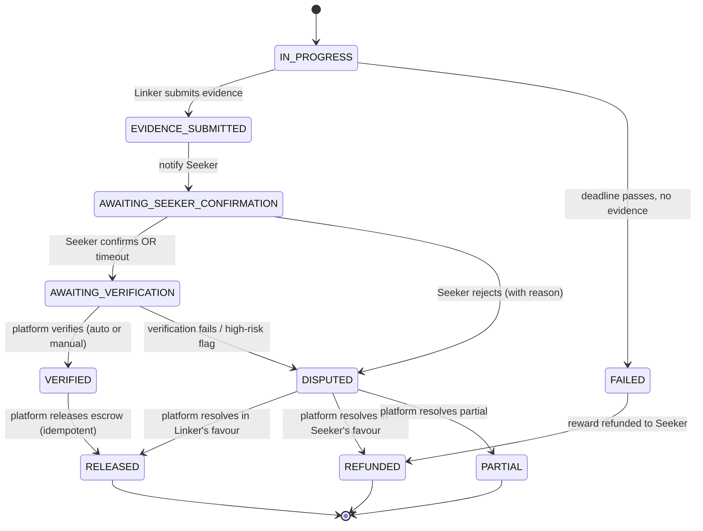

# **JOMLINK PLATFORM BLUEPRINT v1.2 — RISK, LEGAL & SECURITY HARDENING**

> **Version note:** This edition preserves the original product blueprint and adds binding hardening rules in Part 11. Where earlier sections conflict with Part 11, Part 11 is authoritative. Legal and regulatory items are design gates for Malaysian counsel/payment-provider confirmation, not a legal opinion. No production penetration test has been performed as part of this document update.
>
> **v1.2 note (15 October 2026):** This revision makes the **category disable/deny-list rule** explicit and enforceable (§11.9.1), adds a binding **AML/CFT sanctions-screening gate** (§11.2.1), and clarifies PDPA 2010 (as amended 2024) obligations (§11.11). These changes close the gap between what Part 11 *stated* and what the reference implementation actually *enforced*. See Part 13 change log.

## **PART 1 — PRODUCT DEFINITION & USER ARCHITECTURE**

---

# **01 — PRODUCT DEFINITION**

## **1.1 Platform Overview**

**Jomlink** is a marketplace for business introductions that connects individuals seeking access to specific business opportunities, organisations, professionals, decision-makers or networks with individuals who possess relevant professional relationships and are able to facilitate legitimate introductions.

The platform is designed around a simple principle:

> **People who need connections can find people who can make those connections.**

Jomlink acts as the intermediary platform that facilitates:

* Discovery of relevant opportunities;  
* Identification of potential Linkers;  
* Proposal and negotiation of introduction terms;  
* Appointment and connection coordination;  
* Verification of completed introductions;  
* Secure handling of payments;  
* Reputation and performance tracking; and  
* Development of a trusted professional relationship network.

Jomlink is **not intended to guarantee a particular business outcome**. Its primary function is to facilitate legitimate introductions and access to relevant professional networks.

---

## **1.2 Vision**

> **To become a global marketplace for trusted business introductions, enabling people and businesses to connect with the right relationships across borders, industries and markets.**

Jomlink aims to make professional networking more accessible by reducing the traditional dependency on personal networks, geographical limitations and informal introductions.

---

## **1.3 Mission**

> **To make valuable business connections accessible, discoverable and transaction-ready through a trusted global platform.**

Jomlink seeks to transform business networking from an informal activity based primarily on personal relationships into a structured digital marketplace where:

1. Opportunities can be clearly defined;  
2. Relevant connections can be discovered;  
3. Linkers can demonstrate relevant relationships;  
4. Seekers can evaluate and select Linkers;  
5. Expectations and deliverables can be agreed before proceeding;  
6. Connections can be verified;  
7. Payments can be handled securely; and  
8. Successful participants can build measurable reputation over time.

---

## **1.4 Core Proposition**

The core proposition of Jomlink is:

> **Jomlink is a marketplace for business introductions.**

A more descriptive proposition is:

> **Jomlink connects people seeking business opportunities with people who have the relationships and networks to facilitate meaningful introductions.**

The platform therefore operates on the fundamental relationship:

**Demand ↔ Network ↔ Opportunity**

Where:

* **Demand** \= the Seeker's requirement for a particular connection;  
* **Network** \= the Linker's relevant professional relationships; and  
* **Opportunity** \= the structured request through which the connection is facilitated.

---

## **1.5 Core Platform Principles**

### **1.5.1 One Member, Multiple Roles**

Every registered individual has one Jomlink account but may operate in two capacities:

**Seeker**

A Member who creates an Opportunity because they require a specific business introduction or connection.

**Linker**

A Member who uses their professional relationships, experience or network to facilitate an introduction for a Seeker.

A Member may act as both a Seeker and a Linker without maintaining separate accounts.

---

### **1.5.2 Introduction, Not Guaranteed Business Outcome**

Jomlink facilitates introductions rather than guaranteeing commercial results.

For example, a Linker may be engaged to:

* Introduce a Seeker to a company executive;  
* Facilitate a meeting;  
* Establish communication between two parties;  
* Introduce a potential investor;  
* Facilitate access to a potential customer;  
* Connect a business with a potential supplier or partner.

However, Jomlink does not guarantee that the introduction will result in:

* A contract;  
* Investment;  
* Tender award;  
* Purchase;  
* Partnership;  
* Government approval;  
* Employment; or  
* Any other commercial outcome.

The specific deliverable must be clearly defined when an Opportunity is created.

---

### **1.5.3 Transparency of Expectations**

Before a Linker is selected, the Seeker must be able to understand:

* What the Linker claims to be able to facilitate;  
* The nature of the Linker's relationship;  
* The proposed target;  
* The proposed method of introduction;  
* Any limitations or substitutions;  
* The proposed reward; and  
* The expected completion period.

Likewise, the Linker must be able to understand exactly what the Seeker is requesting before submitting a proposal.

---

### **1.5.4 Privacy by Design**

Jomlink will not publicly disclose sensitive relationship information.

A Linker may display information such as:

> Former Employee — Prasarana Malaysia Berhad

or:

> Business Relationship — Property Development Industry

but the platform will not publicly reveal the Linker's:

* Personal contact details;  
* Private phone numbers;  
* Personal email addresses;  
* Exact contact person;  
* Private communication history; or  
* Other confidential relationship information.

Specific contact information may only become available through an authorised workflow and subject to the relevant Seeker acknowledgement.

---

### **1.5.5 Trust Through Verification**

Jomlink will progressively establish trust through:

* Identity verification;  
* Professional history;  
* Relationship declarations;  
* Verified Member status;  
* Completed Opportunities;  
* Successful Connection records;  
* Ratings and reviews;  
* Performance history; and  
* Platform-generated reputation indicators.

The objective is to distinguish between:

> **Someone who claims to know someone**

and

> **Someone whose relevant relationship and successful introduction history can be demonstrated.**

---

# **02 — USER ARCHITECTURE**

## **2.1 Account Structure**

Jomlink will initially operate on an **individual Member account model**.

Each Member creates one account containing their professional identity, experience, business information and relationship information.

The same account can subsequently operate as:

**Member → Seeker**

and/or

**Member → Linker**

There is no requirement for a Member to create separate accounts for each role.

---

# **2.2 Registration**

The initial registration process should capture sufficient information to establish a credible professional identity without creating unnecessary friction.

### **Basic Registration**

Required:

* Full name;  
* Email address;  
* Mobile number;  
* Password;  
* Country;  
* Basic location;  
* Profile photo.

The platform should require:

**Email Verification**

and

**Mobile Number Verification**

before the account becomes fully active.

---

## **2.3 Professional Profile**

Each Member will have a professional profile similar in concept to a professional networking profile.

### **Core Information**

* Full name;  
* Professional headline;  
* Current position;  
* Current organisation;  
* Industry;  
* Country;  
* City/region;  
* Languages;  
* Years of professional experience;  
* Short professional biography.

### **Professional Experience**

Members may add:

* Current employment;  
* Previous employment;  
* Previous positions;  
* Organisations worked with;  
* Business ownership;  
* Consultancy experience;  
* Board or advisory roles;  
* Relevant projects;  
* Industry experience.

Example:

**John Tan**

Managing Director  
 ABC Holdings Sdn Bhd

**Previous Experience**

Senior Manager — Company A  
 Business Development Director — Company B  
 Consultant — Company C

---

# **2.4 Seeker Profile**

There is no separate physical account for a Seeker.

Instead, a Member can activate the Seeker function by creating an **Opportunity**.

The Seeker profile is therefore primarily derived from the Member's:

* Professional profile;  
* Business profile;  
* Organisation;  
* Industry;  
* Location;  
* Opportunity history; and  
* Previous transactions.

The platform may eventually provide a dedicated Seeker reputation score based on factors such as:

* Opportunity quality;  
* Completion behaviour;  
* Cancellation behaviour;  
* Payment history;  
* Dispute history; and  
* Ratings received from Linkers.

---

# **2.5 Linker Profile**

A Member becomes a Linker when they choose to participate in Opportunities.

The Linker profile should display relevant information that helps Seekers evaluate whether the individual is suitable for a particular Opportunity.

### **Linker Profile Components**

* Professional identity;  
* Current and previous positions;  
* Industry experience;  
* Relevant organisations;  
* Relationship categories;  
* Geographic coverage;  
* Languages;  
* Completed Opportunities;  
* Successful Connections;  
* Ratings;  
* Success rate;  
* Response rate;  
* Verification status;  
* Relevant badges.

---

# **2.6 Relationship Declarations**

Relationship information is a core component of the Jomlink platform.

Members may declare organisations, companies, institutions or other entities with which they have relevant professional relationships.

Examples:

> Prasarana Malaysia Berhad  
>  Former Employee

> Maybank  
>  Business Partner

> ABC Property Group  
>  Former Client

> Ministry / Government Agency  
>  Industry Contact

The platform should allow Members to classify the nature of the relationship.

### **Initial Relationship Categories**

* Current Employee;  
* Former Employee;  
* Business Partner;  
* Client;  
* Former Client;  
* Supplier;  
* Customer;  
* Consultant;  
* Advisor;  
* Investor;  
* Professional Contact;  
* Industry Contact;  
* Association / Membership Relationship;  
* Government / Public Sector Relationship;  
* Other.

---

# **2.7 Relationship Visibility**

Relationship information should have different levels of visibility.

### **Public**

Other Members may see:

> **Prasarana Malaysia Berhad — Former Employee**

but not the specific individual contact.

### **Platform-Only**

The underlying relationship data may be used by Jomlink's matching system without being publicly exposed.

### **Opportunity-Specific**

When a Linker applies to an Opportunity, additional relationship information may be disclosed to the Seeker where appropriate.

However:

> **Exact personal contact information remains protected.**

The platform must prevent the relationship database from becoming a mechanism for harvesting personal contact information.

---

# **2.8 Relationship Verification**

For the MVP, relationship verification will primarily occur **when a Member applies to a relevant Opportunity**, rather than requiring every declared relationship to be verified during initial registration.

Example:

A Member declares:

> Prasarana Malaysia Berhad — Former Employee

Later, the Member applies for:

> Introduction to Prasarana Senior Management

At this point, Jomlink may request additional information or verification relating specifically to that relationship.

This approach reduces registration friction while allowing the platform to progressively build a trusted relationship database.

---

# **2.9 KYC and Identity Verification**

Jomlink should support identity verification from the MVP architecture, even if the full verification process is progressively implemented.

### **Basic Member**

* Email verified;  
* Mobile verified.

### **Verified Member**

Additional identity verification may include:

* Government-issued identification;  
* Identity verification process;  
* Selfie/liveness verification where required;  
* Additional verification checks.

A verified Member receives a:

> **Jomlink Verified Badge**

The badge indicates that the Member's identity has been verified by the platform.

It does **not automatically mean that every professional relationship declared by that Member has been verified.**

---

# **2.10 Business Profiles**

A Member may create one or more Business Profiles associated with their account.

Example:

### **ABC Technology Sdn Bhd**

**Industry:** Technology

**Description:**  
 ABC Technology provides enterprise software solutions for...

**Business Objectives:**

* Seeking corporate clients;  
* Seeking strategic partners;  
* Seeking investors;  
* Seeking distribution partners.

Business Profiles provide context when creating Opportunities.

For example, instead of:

> "I want to meet the CEO of Company X."

the Seeker can provide:

> **Business:** ABC Technology Sdn Bhd  
>  **Purpose:** Introduce enterprise software solution  
>  **Target:** Company X  
>  **Target Role:** CEO / Relevant Decision Maker  
>  **Desired Outcome:** Business meeting

This provides the Linker with sufficient context to understand **why the introduction is being requested**.

---

# **2.11 Future Business Accounts**

The MVP will focus primarily on individual Members.

However, the architecture should be designed to support future **Business Accounts**.

A Business Account may eventually allow:

* Multiple employees;  
* Team members;  
* Shared Opportunities;  
* Corporate billing;  
* Company-level verification;  
* Multiple Linkers managed by one organisation;  
* Team permissions;  
* Corporate dashboards;  
* Transaction reporting; and  
* Enterprise subscription plans.

This feature should be treated as a **future-phase capability**, rather than a mandatory MVP feature.

---

# **2.12 Member Identity Architecture**

The intended hierarchy is:

**JOMLINK**

↓

**Member Account**

↓

**Professional Profile**

├── Seeker Capability  
 │ └── Creates Opportunities

└── Linker Capability  
 ├── Relationship Profile  
 ├── Linker Proposals  
 ├── Connections  
 └── Reputation

↓

**Optional Business Profile**

↓

**Future Business Account**

This structure ensures that Jomlink remains fundamentally a **people-and-relationship platform**, while allowing businesses to become increasingly important participants as the platform scales.

---

## **2.13 User Trust Layers**

The long-term trust architecture should progressively evolve into:

**Identity**

> Who is this person?

↓

**Professional History**

> What have they done?

↓

**Relationship**

> Who/what organisations are they connected to?

↓

**Verification**

> Can the relationship or identity be substantiated?

↓

**Transaction History**

> Have they successfully facilitated connections?

↓

**Reputation**

> How reliably do they perform?

↓

**Network Graph**

> What legitimate professional relationships exist within the Jomlink ecosystem?

This trust layer will become one of the platform's most important long-term assets.

# **03 — OPPORTUNITY MARKETPLACE**

## **3.1 Overview**

The **Opportunity Marketplace** is the core marketplace layer of Jomlink.

A Seeker creates an Opportunity describing the business connection, introduction or access they require. Linkers with relevant relationships, experience or network access may then discover and respond to the Opportunity.

An Opportunity should be structured sufficiently to allow Jomlink to:

1. Understand what the Seeker requires;  
2. Identify relevant Linkers;  
3. Determine the expected deliverable;  
4. Establish the agreed reward;  
5. Define the completion deadline;  
6. Facilitate the connection; and  
7. Determine whether the Opportunity has been successfully completed.

---

# **3.2 Opportunity Categories**

The initial Opportunity categories should include:

### **A. Business Introduction**

Introduction to a specific person, company or organisation.

### **B. Executive / Decision-Maker Meeting**

Request for a meeting with a specified executive, senior management member or decision-maker.

### **C. Investor Connection**

Introduction to a potential investor, fund, family office, investment company or other capital provider.

### **D. Customer / Client Connection**

Introduction to a potential customer or commercial client.

### **E. Supplier Connection**

Introduction to a relevant supplier, manufacturer or service provider.

### **F. Distributor / Agent Connection**

Introduction to potential distributors, agents or channel partners.

### **G. Strategic Partner**

Introduction to a potential JV partner, technology partner, business partner or strategic collaborator.

### **H. Government / Public Sector**

Introduction to relevant government departments, agencies or public-sector representatives.

This category should initially be available but classified as **Restricted** where appropriate.

### **I. Professional / Expert**

Introduction to a professional, specialist, consultant, adviser or industry expert.

### **J. Site Visit / Access**

Facilitation of legitimate access to a business location, facility, project site or relevant organisation.

### **K. Other**

For legitimate opportunities that do not fit the standard categories.

---

# **3.3 Opportunity Creation**

The Seeker should be guided through a structured Opportunity creation process.

### **Step 1 — Select Category**

Example:

> Executive / Decision-Maker Meeting

### **Step 2 — Select Target**

The Seeker identifies the desired:

* Person;  
* Organisation;  
* Company;  
* Government entity;  
* Industry;  
* Profession; or  
* Other relevant target.

### **Step 3 — Define Target Role**

Where applicable:

> CEO

> Managing Director

> Chief Procurement Officer

> Head of Business Development

> Investor

> Government Officer

> Relevant Decision Maker

The system should allow the Seeker to specify whether the requested position is:

**Exact**

or

**Flexible / Equivalent**

---

# **3.4 Required Outcome**

The Seeker must define what constitutes successful completion.

Examples:

### **Introduction**

> A direct introduction between the Seeker and Target Person.

### **Contact Facilitation**

> Facilitation of direct communication with the Target Person.

### **Meeting**

> A confirmed meeting between the Seeker and Target Person.

### **Executive Meeting**

> A meeting with the specified senior executive or an approved equivalent.

### **Site Visit**

> A confirmed and completed visit to the specified location.

The Opportunity's reward should be tied to the **defined deliverable**, rather than vague expectations.

---

# **3.5 Target Substitution**

A Linker may sometimes have access to a person who is more appropriate or more accessible than the exact target specified by the Seeker.

For example:

**Seeker Request**

> Meeting with CEO of Company X.

**Linker Proposal**

> I can facilitate a meeting with the COO, who is directly responsible for the relevant business division.

The Linker must clearly state this in the proposal.

The Seeker must then:

> **Acknowledge and Accept**

before the Opportunity proceeds.

If the Seeker does not accept the proposed target or substitution:

* The connection will not proceed;  
* Contact information will not be released through the relevant workflow;  
* The Linker will not be entitled to payment for that proposed outcome; and  
* The Opportunity may remain available to other Linkers.

---

# **3.6 Opportunity Description**

The Seeker should provide sufficient context without being required to disclose sensitive information publicly.

Recommended fields:

* Opportunity title;  
* Category;  
* Target entity;  
* Target person/role;  
* Purpose of introduction;  
* Business description;  
* Required outcome;  
* Preferred connection method;  
* Acceptable alternatives;  
* Geographic preference;  
* Deadline;  
* Offer amount;  
* Confidentiality level;  
* Additional requirements.

---

# **3.7 Confidentiality Levels**

Opportunities should have configurable visibility.

### **Public**

Visible to all eligible Linkers.

### **Matched**

Primarily surfaced to Linkers identified by the matching engine as potentially relevant.

### **Restricted**

Visible only to selected categories, verified Linkers or approved users.

### **Private / Direct**

Opportunity may be offered directly to selected Linkers.

The system should not expose sensitive information unnecessarily.

---

# **3.8 Opportunity Reward**

The Seeker determines the initial reward for the Opportunity.

Example:

> **Offer: RM500**

The Linker may:

* Accept the offer;  
* Submit a lower proposed reward; or  
* Submit a higher counter-offer.

Both parties may negotiate until an agreed amount is reached.

The final agreed amount becomes the:

> **Confirmed Opportunity Reward**

---

# **3.9 Jomlink Posting Deposit**

When the Seeker creates and posts an Opportunity, the Seeker pays a **posting deposit** equal to:

> **10% of the Opportunity Reward**

The posting deposit is a **conditional deposit comprising a listing/moderation charge and a refundable balance**, subject to the outcome rules below. It **includes** a flat **RM10 listing fee** - the listing fee is **taken from inside the 10% deposit** and is **never charged on top of it**. This is a proposed commercial model and must not be activated until Malaysian legal and payment-provider review confirms that the collection, holding and refund flow is lawful and contractually clear.

> **The RM10 listing fee is a portion of the 10% posting deposit - it is not an additional charge.**
> The total amount charged to the Seeker when posting is therefore **exactly 10% of the reward** (subject to the RM10 minimum described below).

Example:

**Opportunity Reward:** RM500  
 **10% Posting Deposit:** RM50  
 **RM10 Listing Fee (inside the RM50):** RM10  
 **Remaining Refundable Portion:** RM40

### **Automatic Wallet Deduction**

The 10% posting deposit is charged through the approved payment-provider flow at the moment the Opportunity is posted. If an internal wallet/ledger is retained, it must not represent unapproved stored value or imply that users can withdraw or transfer funds outside the approved flow.

> **A Seeker cannot post an Opportunity unless their wallet holds sufficient credit to cover the 10% posting deposit.**

Seekers may post **as many Opportunities as they wish**, provided each posting is covered by sufficient wallet credit.

### **Where the deposit goes - by outcome**

The 10% deposit is handled differently depending on how the Opportunity ends:

| Outcome | What happens to the deposit |
| --- | --- |
| **Cancelled before any Linker is selected** | The deposit is **refunded to the Seeker, less the RM10 listing fee**. Example: a RM50 deposit → RM10 kept as listing fee, **RM40 refunded**. |
| **Successful completion** (reward released to the Linker) | The **entire deposit is consumed** and kept by the platform. It is **not** refunded. |
| **Failure / expiry / dispute** (after a Linker was selected) | The deposit is **consumed**; only the **reward** is refunded to the Seeker according to the refund rules. |

> **The RM10 listing fee is always retained by Jomlink. It is the only part of the deposit that survives a pre-selection cancellation.**
>
> **Note on small opportunities:** because the RM10 listing fee sits inside the deposit, an Opportunity whose 10% deposit is **less than RM10** cannot be posted. The reward must therefore be at least **RM100** (so that 10% ≥ RM10).

### **Reward Funding Is Separate from the Deposit**

The **reward itself is not charged at posting**. The reward is funded only when the Seeker accepts a Linker, subject to the payment architecture and provider-supported marketplace flow approved for launch. Until written legal review confirms otherwise, “wallet” means a transaction ledger/interface and **must not be treated as authority for Jomlink to issue stored value, hold client money, or operate an unlicensed escrow/payment service**. Reward funds must be handled through a suitably licensed/registered payment provider or other legally approved arrangement. See **§5.7** and **Part 11 — Legal, Financial & Security Hardening**.

> **Posting an Opportunity requires only the 10% deposit. Accepting a Linker requires full settlement of the reward.**

Where an Opportunity is genuinely failed because the selected Linker did not complete the agreed work, the **reward** is refunded to the Seeker according to the platform's refund rules.

---

# **3.10 Opportunity Editing (Seeker)**

A Seeker may edit their own posted Opportunity while it is still "open" and no Linker has committed to specific terms. Editing is an owner-only capability.

### **Who may edit**

Only the Seeker who created the Opportunity (the owner) may edit it. No other Member — including Linkers — can edit an Opportunity they did not create.

### **When editing is allowed**

An Opportunity is editable only while **both** of the following are true:

1. The Opportunity is in a pre-commitment status — `DRAFT`, `PENDING_PAYMENT`, or `ACTIVE`; and
2. **No Linker has submitted a proposal** for that Opportunity.

### **When editing is locked**

> **Once a Linker submits a proposal, the Opportunity can no longer be edited.**

This is the key editing rule. A Linker has based their proposal — relationship, target, deliverable and proposed reward — on the exact terms shown when they applied. Freezing the listing at the first proposal protects the Linker from having the goalposts moved after they have committed time and relationship disclosure to the Opportunity.

Editing also remains locked once a Linker is selected, the reward is funded into escrow, or the Opportunity has otherwise progressed past commitment. Editing never reopens; the listing is committed from the first proposal onward.

The rule applies as soon as **any** proposal exists, regardless of whether the Opportunity's stored status has yet advanced to `Proposal Received`.

### **Enforcement**

This is a **platform-enforced rule**, not merely a UI convention. The protection is applied at every layer:

- The edit form is unavailable once a proposal exists;
- The server rejects any edit attempt for an Opportunity with an existing proposal, even if the request is made directly; and
- Ownership (creator match) is re-checked on every edit request.

### **Editing terms after commitment**

After the listing is locked, changes to the commercial terms (reward, target, deliverable, deadline) are handled through the negotiation / acknowledgement workflow — not by silently editing the original listing. See §3.5 (Target Substitution), §5.6 (Negotiation) and §9.17 (Marketplace Terms, which requires a new version and acknowledgement for any post-agreement modification).

---

# **3.11 Opportunity Status**

Each Opportunity should have a defined lifecycle.

### **Draft**

Opportunity is being prepared.

### **Pending Payment**

Required funding has not yet been completed.

### **Active**

Opportunity is available to Linkers.

### **Proposal Received**

One or more Linkers have submitted proposals.

### **Negotiation**

Seeker and Linker are negotiating terms.

### **Linker Selected**

A Linker has been selected. The reward has settled into escrow.

### **Deadline Requested**

The Linker has proposed a task deadline and it is awaiting the Seeker's acceptance (§5.6.1). The Opportunity is not yet formally in progress.

### **Awaiting Confirmation**

Required acknowledgements or conditions have not yet been completed.

### **In Progress**

The Seeker has accepted the task deadline and the Linker is actively performing the agreed work. The **progress report thread** (§5.6.2) is open until the deadline ends.

### **Flagged**

The task deadline has been missed and a **yellow flag** has been raised against the Linker (§5.6.1). The Opportunity is not yet failed — delivery, or an accepted extension, may still clear the flag.

### **Appointment Scheduled**

A connection/meeting has been scheduled.

### **Evidence Submitted**

The Linker has submitted completion evidence; the Seeker is being asked to confirm or reject it (§5.12).

### **Awaiting Seeker Confirmation**

The Seeker must confirm or reject the submitted evidence within `SEEKER_CONFIRM_WINDOW` (§5.7).

### **Awaiting Verification**

The Seeker has confirmed (or the confirmation window elapsed); the platform is verifying the evidence within `VERIFICATION_WINDOW` (§5.7).

### **Verified**

The platform's verification passed; release is imminent (§5.7).

### **Completed**

The Opportunity has been successfully completed and the reward released.

### **Disputed**

A party has raised a dispute.

### **Failed**

The Linker did not complete the agreed deliverable.

### **Expired**

The Opportunity reached its deadline without successful completion.

### **Cancelled**

The Opportunity was cancelled under the applicable cancellation rules.

---

# **3.12 Opportunity Marketplace**

The marketplace should allow Linkers to browse available Opportunities.

Recommended filters:

* Category;  
* Country;  
* City;  
* Industry;  
* Target entity;  
* Target role;  
* Reward;  
* Deadline;  
* Connection type;  
* Remote / physical;  
* Verified-only opportunities;  
* Match score.

Example marketplace listing:

> **Executive Introduction — Prasarana Malaysia Berhad**  
>  Executive / Decision-Maker Meeting  
>  Reward: RM500  
>  Location: Kuala Lumpur  
>  Deadline: 7 working days  
>  **92% Match**

---

# **04 — MATCHING ENGINE**

## **4.1 Purpose**

The Matching Engine is responsible for connecting Opportunities with Linkers who are most likely to successfully facilitate the requested connection.

The system should not simply match keywords.

It should evaluate the **quality and relevance of relationships**.

---

# **4.2 Primary Matching Factors**

The initial matching engine should consider:

### **1\. Target Entity**

Does the Linker have a relationship with the requested organisation?

### **2\. Relationship Type**

How is the Linker connected?

For example:

* Current employee;  
* Former employee;  
* Supplier;  
* Customer;  
* Business partner;  
* Consultant;  
* Professional contact.

### **3\. Professional History**

Has the Linker previously worked in the target organisation or industry?

### **4\. Target Role**

Does the Linker's relationship provide plausible access to the requested role?

### **5\. Industry**

Does the Linker's professional background match the Opportunity?

### **6\. Geography**

Is the Linker located in the relevant market or geographic area?

### **7\. Language**

Can the Linker communicate effectively with the relevant parties?

### **8\. Historical Performance**

Has the Linker previously completed similar Opportunities?

### **9\. Reputation**

Consider:

* Rating;  
* Success rate;  
* Completion rate;  
* Response rate;  
* Dispute history.

### **10\. Relationship Verification**

Verified relationships should receive a stronger matching weight than unverified declarations.

---

# **4.3 Connection Degrees**

The platform should support different levels of network proximity.

### **First Degree**

Linker has a direct relationship with the target person/entity.

### **Second Degree**

Linker knows someone who has a relevant relationship with the target.

### **Third Degree**

The relationship requires an additional intermediary.

Example:

**Seeker → Linker A → Linker B → Target**

The system should clearly identify the connection degree without unnecessarily exposing private relationship details.

---

# **4.4 Match Score**

Each Opportunity may receive a calculated Match Score.

Example:

> **92% Match**

The score can be based on weighted factors such as:

| Factor | Indicative Weight |
| ----- | ----- |
| Target Entity Relationship | 30% |
| Relationship Strength | 20% |
| Target Role Relevance | 15% |
| Professional / Industry Relevance | 10% |
| Connection Degree | 10% |
| Historical Success | 5% |
| Geographic Relevance | 5% |
| Reputation / Trust | 5% |

These percentages are **initial design parameters**, not final production values. They should be calibrated using actual marketplace data.

---

# **4.5 Matching Does Not Guarantee Access**

The Match Score represents the platform's assessment of **potential relevance**.

It must not be presented as:

> "92% chance of getting the meeting."

Instead:

> **92% Match**

meaning:

> The Linker's profile and declared network appear highly relevant to the Opportunity.

---

# **4.6 Automatic Notifications**

When a new Opportunity matches a Linker's profile, the Linker may receive:

> **New Opportunity Match**

Example:

> Someone is looking for an introduction to senior management at Prasarana Malaysia Berhad.

> Your professional profile indicates a potentially relevant relationship.

> Reward: RM500  
>  Deadline: 7 working days

> **View Opportunity**

Notification channels may include:

* In-app notification;  
* Push notification;  
* Email;  
* SMS/WhatsApp in future phases, subject to consent and cost.

---

# **4.7 Matching Privacy**

The matching engine should use relationship data without exposing the underlying private relationship database.

For example, the system may tell a Seeker:

> **This Linker has a relevant relationship with Prasarana Malaysia Berhad.**

It should not reveal:

> "This Linker's contact is Ahmad, whose mobile number is..."

unless the relevant workflow explicitly permits disclosure.

---

# **05 — LINKER WORKFLOW**

## **5.1 Opportunity Discovery**

A Linker may discover Opportunities through:

1. Personalised matching notifications;  
2. Opportunity Marketplace;  
3. Search;  
4. Category browsing;  
5. Recommended Opportunities;  
6. Direct invitations.

The Linker can review the Opportunity before deciding whether to participate.

---

# **5.2 Linker Proposal**

A Linker submits a structured proposal.

### **Required Information**

**Relationship**

> Former employee of Prasarana Malaysia Berhad.

**Relationship Category**

> Former Employee

**Relationship Relevance**

> Previously worked with the corporate affairs division and maintain professional relationships within the organisation.

**Proposed Connection**

> COO / relevant senior management.

**Proposed Method**

> Direct introduction followed by an online or physical meeting.

**Proposed Deliverable**

> Confirmed meeting with the proposed target.

**Proposed Reward**

> RM700

**Remarks**

> The requested CEO is not my direct contact. I can potentially facilitate access to the COO, who oversees the relevant business function.

---

# **5.3 Relationship Declaration**

When submitting the proposal, the Linker must identify the basis of their claimed relationship.

The platform may request:

* Relationship type;  
* Organisation;  
* Relevant period;  
* Position;  
* General nature of relationship;  
* Connection degree;  
* Supporting information where required.

Exact personal contact information remains hidden.

---

# **5.4 Relationship Verification**

For MVP, verification should occur primarily at the point where the relationship becomes relevant to a live Opportunity.

Potential verification methods include:

* Professional history;  
* Employment information;  
* Company records;  
* Platform history;  
* Supporting documentation;  
* Confirmation from relevant parties where appropriate;  
* Successful prior transactions.

The platform should avoid requiring excessive evidence for low-risk Opportunities while applying stronger verification to higher-value or sensitive Opportunities.

---

# **5.5 Proposal Evaluation**

The Seeker can compare Linker proposals.

The comparison should include:

* Linker identity;  
* Verified status;  
* Relevant professional experience;  
* Relationship category;  
* Connection degree;  
* Proposed target;  
* Proposed method;  
* Proposed deliverable;  
* Reward;  
* Rating;  
* Successful Opportunities;  
* Success rate;  
* Relevant reviews.

Sensitive relationship details remain protected.

---

# **5.6 Negotiation**

Negotiation between the Seeker and the Linker **opens as soon as the Seeker has accepted the Linker** (§5.7) and remains available until both parties lock the agreed terms. This includes the **task deadline**, which the Linker requests and the Seeker accepts through the negotiation workflow described in §5.6.1.

Both parties may negotiate:

* Reward;  
* Target;  
* Deliverable;  
* Connection method;  
* Deadline;  
* Appointment conditions;  
* Acceptable alternatives.

Example:

**Seeker Offer**

RM500

↓

**Linker Counter**

RM800

↓

**Seeker Counter**

RM650

↓

**Linker Accepts**

RM650

The platform then records:

> **Final Agreed Reward: RM650**

The agreed commercial terms should become locked once both parties confirm. Deadline agreement is a **separate, independently recorded step** (§5.6.1) so that the task deadline always has its own timestamped record.

---

# **5.6.1 Deadline Setting & Linker Commitment Flag**

Deadline setting is a **distinct, timestamped step** that sits between commercial agreement and the start of active work. It must be recorded separately from the negotiation trail so the platform can prove **when** a task was due and **what** the Seeker required.

### **Step 1 — Linker Requests the Task Deadline**

Once the commercial terms are agreed, the **Linker proposes the task deadline** — the date by which the agreed deliverable will be delivered.

> **Deadline Request**

> Linker: LNK-1042  
> Proposed task deadline: 18 October (7 working days)  
> Deliverable: Executive introduction to the target decision-maker  
> Reason: Target is available after the 15th.

The platform records the request as an immutable, timestamped entry in the Deal Record (§9.13) carrying:

* The proposed task deadline;
* The Linker who proposed it;
* The agreed deliverable the deadline applies to;
* The request timestamp.

### **Step 2 — Seeker Response**

The Seeker may:

**Accept**

or

**Reject / Request a Change**

If accepted, the proposed deadline becomes the **official task deadline**, the reward remains in escrow, and the task moves to `IN_PROGRESS`.

If rejected or a change is requested, the terms **reopen for negotiation** (§5.6) and the Linker submits a revised deadline. No task deadline is official until the Seeker accepts one.

### **Step 3 — The Linker Commitment Flag (Yellow Flag)**

Jomlink does not treat an uncommitted deadline as a neutral state. A deadline the Linker has **requested but not yet been accepted** carries a visible commitment risk.

> **A Linker who has set a deadline but cannot deliver the task by that deadline receives a YELLOW FLAG.**

The yellow flag is a **commitment-confidence signal**, not a penalty and not a dispute. It is raised when either of the following occurs:

* The Linker withdraws, revises or fails to honour a deadline they themselves proposed; or
* The official task deadline passes without the deliverable being submitted and without an approved extension (§5.14).

Rules governing the flag:

* The flag is **visible to the Seeker** on the Deal Record, and summarized on the Linker's profile as a commitment indicator.
* The flag is **cleared automatically** if the Linker delivers before the deadline, or if the Seeker accepts a valid extension.
* The flag **feeds the Linker Performance Record** (§5.15) and contributes to the Reputation System. Repeated yellow flags are an abuse signal for Fraud & Abuse Management (§9.12).
* The flag is **evidence-bearing**: it records the offending deadline, the Linker, and the timestamp, so it can be relied upon in a later dispute (§9.11).

> **A yellow flag does not by itself release the reward.** The Linker may still complete the Opportunity. Only a failure under §5.13 releases the reward back to the Seeker.

---

# **5.6.2 Progress Report Thread**

Once the Seeker accepts the deadline, the Linker keeps the Seeker informed by posting a **progress report** — a running, timestamped thread of work updates against the agreed deliverable.

> **Progress report entries, and every comment made on them, are stored permanently by Jomlink and are treated as the primary contemporaneous record of the engagement.**

This thread is the platform's **evidence of record**. Either party may later rely on it to prove the state of the work at any point in time.

### **Who Posts**

| Actor | May post a progress report | May comment on a report |
|---|---|---|
| **Linker** | ✓ Yes — this is the Linker's reporting obligation | ✓ Yes |
| **Seeker** | — No | ✓ Yes |
| **Administrator** | — Only as a moderation action | ✓ Yes (moderation note) |

### **Progress Report Entry**

A Linker's progress report may include:

* A free-text update on progress;
* The current status (on track / at risk / blocked / complete);
* A percentage or milestone indicator;
* Attachments supporting the update (meeting confirmation, screenshot, communication evidence);
* A revised completion estimate, where the deadline is at risk.

A report may be posted **at any time until the task deadline ends**. Posting stops when the Opportunity reaches `COMPLETED`, `FAILED`, `EXPIRED` or `DISPUTED`.

### **Comments**

Both the Linker and the Seeker may comment on any progress report. Comments form a **thread** attached to the report and are an equal part of the evidence of record.

### **Immutability, Editing & Update History**

To keep the thread trustworthy as evidence, Jomlink never destroys what a party previously wrote.

* Both the Linker and the Seeker **may edit their own comment** on a progress report.
* **Every edit preserves the previous version as update history.** The prior text, the author, and the timestamp of the edit are retained and remain visible to the author, the counterparty, and the administrator.
* A comment may be **edited or added to** — but the original wording can never be silently removed.
* The visible comment shows the current text together with an **"edited"** marker and the number of revisions. The full revision history is available to the parties and to dispute administration.

> **Nothing written in a progress report or its comments is ever destroyed, including edits.**

This guarantees that if a dispute occurs later (§9.11), both parties and the administrator can reconstruct **exactly what was claimed, by whom, and when** — including any change of position between versions.

---

# **5.7 Linker Selection**

The Seeker selects one or more Linkers according to the Opportunity's configured funding model.

### **Full Reward Settlement Required**

Before a Linker can be selected, the Seeker must have **full settlement of the agreed reward** available in their Jomlink wallet. The reward is **not** charged at posting - only the 10% posting deposit is. Accepting a Linker's submission is the point at which the Seeker commits the full reward.

> **The Seeker cannot accept a Linker's submission unless their wallet holds sufficient credit to cover the full agreed reward.**

On acceptance, the full reward must be confirmed as funded and reserved through the approved payment-provider arrangement before the Linker becomes committed. The platform records a corresponding transaction-ledger entry. Release or refund must be executed by the authorised provider flow and only after the state-machine checks below.

### **Escrow Release Model (authoritative)**

The escrow release is a **platform-owned, verification-gated event** — not a Seeker-triggered one.

> **The Seeker confirms. The Seeker does not pay. The Linker submits. The Linker does not self-certify. Only the platform releases escrow — and only after verification.**

The Seeker's confirmation is **one input** into a platform-owned release decision. It is never, by itself, the release action.

#### **Completion state machine**

#### **State transition table**

| From | To | Trigger | Actor | Escrow |
|------|----|---------|-------|--------|
| `IN_PROGRESS` | `EVIDENCE_SUBMITTED` | Evidence uploaded (immutable, timestamped) | Linker | Held |
| `EVIDENCE_SUBMITTED` | `AWAITING_SEEKER_CONFIRMATION` | Automatic, Seeker notified | System | Held |
| `AWAITING_SEEKER_CONFIRMATION` | `AWAITING_VERIFICATION` | Seeker confirms **or** `SEEKER_CONFIRM_WINDOW` elapses | Seeker / System | Held |
| `AWAITING_SEEKER_CONFIRMATION` | `DISPUTED` | Seeker rejects with a stated reason | Seeker | **Frozen** |
| `AWAITING_VERIFICATION` | `VERIFIED` | Automated checks pass (or manual review approves) | Platform | Held |
| `AWAITING_VERIFICATION` | `DISPUTED` | Checks fail / high-risk flag raised | Platform | **Frozen** |
| `VERIFIED` | `RELEASED` | Escrow paid to Linker, less 10% fee | **Platform only** | Released |
| any pre-release state | `DISPUTED` | Either party raises a dispute | Either | **Frozen** |
| `IN_PROGRESS` | `FAILED` | Deadline passes, no evidence, no accepted extension | System | Held |
| `FAILED` | `REFUNDED` | Reward returned to Seeker | Platform | Refunded |
| `DISPUTED` | `RELEASED` / `REFUNDED` / `PARTIAL` | Adjudication (§9.11) | Platform | Settled |

#### **Timeout constants (configurable)**

| Constant | Default | Purpose |
|----------|---------|---------|
| `SEEKER_CONFIRM_WINDOW` | 3 days | Seeker must confirm/reject evidence. **Timeout auto-advances to verification** — a silent Seeker can never block payment. |
| `VERIFICATION_WINDOW` | 2 days | Target for routine verification only. **Timeout does not auto-release** if a dispute, fraud flag, sanctions/compliance review, payment-provider hold or high-risk hold is active. Escalate to manual review and notify both parties. |
| `EVIDENCE_CURE_WINDOW` | 3 days | Linker may fix deficient evidence before it is treated as failure. |
| `DISPUTE_WINDOW` | 7 days | Post-release clawback window (see anti-collusion gates). |
| `HIGH_RISK_HOLD` | Minimum 7 days (configurable by risk policy) | Mandatory minimum hold for designated high-risk completions. The hold overrides every routine timeout and remains until a documented authorised decision clears it. |

#### **Release sequence**

1. **Linker submits evidence** → `EVIDENCE_SUBMITTED`. The submission is immutable and timestamped, and the Seeker is notified. This is the point at which the Linker's obligation is *prima facie* discharged.
2. **Seeker responds** within `SEEKER_CONFIRM_WINDOW`:
   - **Confirm** → `AWAITING_VERIFICATION`.
   - **Reject (with reason)** → `DISPUTED`, escrow frozen. A bare rejection is **not** a refund — it opens adjudication.
   - **No response** → auto-advance to `AWAITING_VERIFICATION`. Silence is treated as non-objection, never as a veto.
3. **Platform verifies** within `VERIFICATION_WINDOW`:
   - Automated evidence checks + risk scoring (see §5.12.1) pass → `VERIFIED`; release only if no dispute, compliance hold, payment-provider hold or high-risk hold remains.
   - Checks fail / high-risk flag → manual review → `VERIFIED` or `DISPUTED`; no automatic release during unresolved review.
4. **Release** is a platform-only, exactly-once action. `RELEASED`, `REFUNDED`, `VOID`, and `HELD` are terminal states and are never re-released.

#### **Idempotency**

Release happens **exactly once** through a provider-supported idempotent operation. A connection already `RELEASED`, `REFUNDED`, or `VOID` is never settled again. `HELD` blocks settlement but may later transition to an authorised release/refund after review. Every provider callback and retry must be idempotent.

> **In one line:** the Seeker *confirms* completion; the platform *verifies* it; only the platform *pays* the Linker. The 7-day window is a fallback safety net, never the payment date.

Before the selected Linker can proceed, the platform verifies that:

* Full reward settlement is available and held in escrow;
* The Opportunity remains active;
* The proposed terms have been accepted;
* Any target substitution has been acknowledged;
* Required KYC conditions are satisfied; and
* The relevant connection workflow can begin.

---

# **5.8 Multiple Linkers**

Jomlink will support multiple Linkers for the same Opportunity.

The Seeker may choose between:

### **Shared Reward Model**

Multiple Linkers compete for the same Opportunity reward.

Example:

> RM500 total reward

Only the Linker who successfully satisfies the defined completion criteria receives the reward.

### **Multiple Funded Linker Model**

The Seeker may separately fund multiple Linkers.

Example:

> Linker A — RM500  
>  Linker B — RM500

Each Linker has a separately funded Opportunity allocation and may receive payment if they independently satisfy the agreed completion criteria.

Additional Linker participation should require the Seeker to make the appropriate additional funding/payment.

---

# **5.9 Appointment Arrangement**

Once a Linker is selected, the parties proceed to appointment coordination.

The Opportunity specifies the allowed completion period, such as:

* 3 working days;  
* 5 working days;  
* 7 working days; or  
* Custom period.

The Linker proposes:

* Date;  
* Time;  
* Location / online platform;  
* Target person;  
* Connection method;  
* Additional remarks.

---

# **5.10 Seeker Acknowledgement**

Before sensitive contact information is released or the final connection stage proceeds, the Seeker must acknowledge the proposed arrangement.

Example:

> **Proposed Connection**

> Target requested: CEO  
>  Proposed connection: COO  
>  Reason: Relevant business division and direct professional relationship.

> **\[Accept & Proceed\]**

> **\[Reject\]**

If the Seeker rejects the proposal, the workflow does not proceed under that proposed connection.

---

# **5.11 Connection Confirmation**

Once the Seeker acknowledges the terms:

**Opportunity Status**

> `IN PROGRESS`

The parties may proceed with the introduction and appointment.

The platform records:

* Agreed reward;  
* Target;  
* Accepted alternative, if any;  
* Deadline;  
* Linker;  
* Seeker;  
* Agreed deliverable;  
* Appointment details.

This becomes the basis for determining successful completion.

---

# **5.12 Linker Completion**

After the introduction or meeting, the Linker submits the required completion evidence.

Depending on Opportunity type, this may include:

* Introduction confirmation;  
* Communication evidence;  
* Meeting details;  
* Meeting photograph;  
* Online meeting screenshot;  
* Appointment confirmation;  
* Target acknowledgement;  
* Other relevant evidence.

The exact evidence requirement should depend on the Opportunity category.

> **The Seeker confirms; the platform verifies; only the platform releases.** Once the Linker submits evidence, the Seeker confirms or rejects it within `SEEKER_CONFIRM_WINDOW`, the platform verifies it within `VERIFICATION_WINDOW`, and only then is the escrowed reward released to the Linker (less the 10% Linker service fee). The Seeker's confirmation is **not** the release action — see **§5.7 — Escrow Release Model**.

---

## **5.12.1 Anti-Collusion Gates**

The platform cannot prevent two parties from *attempting* to fake a completion, but it makes faking expensive and detectable. These gates are **enforced**, not advisory.

### **Category-specific evidence requirements**

Evidence requirements are a **hard gate** per Opportunity category, not a suggestion. For meeting-type Opportunities, the strongest signal is **target acknowledgement**: the Linker sends the target a Jomlink-generated confirmation link, and the target confirms the meeting occurred. This requires the *actual target's* action, which a colluding Seeker–Linker pair cannot fabricate without the target's cooperation.

### **Risk scoring on every completion**

A completion is flagged **high-risk** when any of the following hold:

* Evidence is submitted less than a configurable minimum time after deadline acceptance;
* The Linker is a first-time Linker **and** the Seeker is a first-time Seeker;
* Zero progress reports were posted during the engagement;
* Evidence originates from non-corporate or unverifiable sources.

### **Mandatory hold**

High-risk completions are subject to `HIGH_RISK_HOLD` before release, during which fraud checks run and the completion is flagged for manual review.

### **Post-release clawback**

Within `DISPUTE_WINDOW` after release, a dispute may still be raised. It is treated as a **clawback dispute**: the platform investigates and may reverse the payout by recovering from the Linker's wallet balance. This closes the "Seeker discovers the meeting was fake a week later" gap.

### **Edge-case resolution**

| Scenario | Outcome |
|----------|---------|
| Seeker ghosts after evidence | Auto-advance → verify → release if evidence passes. **Linker gets paid.** |
| Linker ghosts (no evidence) | Deadline passes → `FAILED` → refund to Seeker (§5.13 unchanged). |
| Both ghost | Deadline passes → `FAILED` → refund. |
| Seeker rejects evidence | `DISPUTED`, escrow frozen, adjudication — not a silent refund. |
| Deficient evidence | Linker gets `EVIDENCE_CURE_WINDOW` to fix; then verify or dispute. |
| Collusion (fake meeting) | Target acknowledgement + risk scoring + hold + clawback. |
| Platform stalls | `VERIFICATION_WINDOW` timeout auto-releases with a review flag. |

---

# **5.13 Failed Opportunity**

An Opportunity is considered failed when the Linker does not complete the agreed deliverable within the applicable deadline and no approved extension or valid exception applies.

When the official task deadline (§5.6.1) passes without delivery, the platform updates the **Linker Performance Record** (§5.15), where the missed deadline is recorded as a **yellow flag** against the commitment made by the Linker. A pattern of yellow flags across Opportunities is treated as an abuse signal (§9.12).

A failed Opportunity may result in:

* Reward returned to Seeker;  
* Applicable fee refunded according to policy;  
* No Linker payout;  
* Performance record updated;  
* Yellow flag recorded against the missed deadline;  
* Success rate affected;  
* Potential warning or penalty for repeated failures.

---

# **5.14 Extension**

A Linker may request an extension before the Opportunity expires. An extension is the Linker's **corrective action for an at-risk deadline**: it prevents the missed deadline from hardening into a yellow flag.

Example:

> **Extension Request**

> Current deadline: 14 September  
>  Requested new deadline: 18 September

> Reason: Target requested a rescheduled meeting.

The Seeker may:

**Accept**

or

**Reject**

If accepted, the new deadline becomes the official Opportunity deadline and the yellow flag is **cleared** for the original deadline.

If rejected, the original deadline remains applicable and the yellow flag **remains raised** if the deadline is subsequently missed.

Extension requests must be raised through the **progress report thread** (§5.6.2) so that the reason, the timestamps and both parties' positions form part of the permanent evidence of record.

---

# **5.15 Linker Performance Record**

Every completed Opportunity contributes to the Linker's professional reputation.

The platform should track:

* Opportunities accepted;  
* Opportunities completed;  
* Successful Connections;  
* Success rate;  
* Average completion time;  
* Response rate;  
* Cancellation rate;  
* Dispute rate;  
* **Deadlines requested;**
* **Deadlines met;**
* **Deadlines missed;**
* **Yellow flags raised;**
* **Yellow flags cleared on delivery;**
* **Average response time in the progress report thread;**
* **Average rating;**
* Relevant categories;  
* Verified relationships.

This information forms the basis of Jomlink's **Linker Reputation System**.

The commitment metrics are derived directly from the **deadline record** (§5.6.1) rather than from self-reporting: a deadline is "met" only when the deliverable was submitted before an accepted deadline, and a yellow flag is raised only when a Linker-proposed deadline was missed without an accepted extension (§5.14).

---

# **5.16 End-to-End Linker Flow**

The complete MVP workflow is:

**Opportunity Created**

↓

**Matching Engine**

↓

**Linker Notification**

↓

**Linker Views Opportunity**

↓

**Relationship Declared**

↓

**Linker Submits Proposal**

↓

**Negotiation**

↓

**Seeker Selects Linker**

↓

**Linker Requests Task Deadline**

↓

**Seeker Accepts Deadline**  
*(if rejected → back to Negotiation)*

↓

**Task In Progress — Progress Report Thread Opens**

↓

**Linker Posts Progress Reports**

↓

**Linker & Seeker Comment on Reports**  
*(edits preserved as update history)*

↓

**Deadline Reached**

↓

**(A) Delivered on time → Evidence Submitted → Seeker Confirmation → Platform Verification → Successful Connection → Payment Release → Rating & Reputation Update**

|  |
| :--- |
| **(B) Deadline missed → Yellow Flag raised → Extension requested?** |
| * Extension accepted → deadline extended, flag cleared → back to Task In Progress |
| * No extension → Failed Opportunity → reward returned to Seeker → reputation update |

---

# **5.17 End-to-End Seeker Flow**

The complete Seeker-side workflow is:

**Opportunity Posted & Funded (10% deposit)**

↓

**Proposals Received**

↓

**Negotiation**

↓

**Seeker Accepts Linker**  
*(full reward settles into escrow)*

↓

**Linker Requests Task Deadline**

↓

**Seeker Accepts / Rejects Deadline**

↓

**Seeker Watches Progress Report Thread until the Deadline Ends**

↓

**Seeker Comments on Reports**  
*(seeker's own edits preserved as update history)*

↓

**Deadline Reached**

↓

**(A) Successful delivery → Acknowledgement → Evidence Review → Seeker Confirmation → Platform Verification → Payment Release → Rating & Reputation Update**

> **"Confirmation" and "Payment Release" are separate steps owned by different actors.** The Seeker confirms the evidence; the platform verifies it; only the platform releases the reward. The Seeker's confirmation is never, by itself, the release action. The 7-day window is a fallback safety net only — see **§5.7 — Escrow Release Model**.

|  |
| :--- |
| **(B) Deadline missed → Seeker sees the Yellow Flag against the Linker** |
| * Seeker may accept an extension request (clears the flag), or |
| * Seeker may allow the Opportunity to fail → reward refunded, dispute may be raised (§9.11) citing the progress report thread as evidence of record. |

---

# **09 — ADMINISTRATION & COMPLIANCE**

## **9.1 Overview**

The Jomlink Admin System provides central control over:

* Members;  
* KYC and verification;  
* Opportunities;  
* Linker relationships;  
* Transactions;  
* Disputes;  
* Fraud detection;  
* Restricted categories;  
* Content moderation;  
* Platform fees;  
* Reputation;  
* System configuration; and  
* Audit records.

The admin architecture should be designed from the beginning as a **role-based administration system**, rather than giving all internal staff unrestricted access.

---

# **9.2 Admin Roles**

The initial system should support separate administrative roles.

### **Super Administrator**

Full system access.

### **Operations Administrator**

Manages:

* Opportunities;  
* Members;  
* Connections;  
* Operational issues.

### **KYC / Verification Administrator**

Manages:

* Identity verification;  
* Relationship verification;  
* Verification documents;  
* Verification status.

### **Finance Administrator**

Manages:

* Payments;  
* Refunds;  
* Payouts;  
* Transaction reconciliation;  
* Fees.

### **Dispute Administrator**

Manages:

* Disputes;  
* Evidence;  
* Resolution;  
* Payment holds.

### **Compliance Administrator**

Manages:

* Restricted categories;  
* Prohibited activities;  
* Regulatory controls;  
* Compliance investigations.

### **Support Administrator**

Handles:

* Customer support;  
* Account issues;  
* General enquiries.

Each role should have permission-based access.

---

# **9.3 Role-Based Access Control**

The platform should implement:

> **RBAC — Role-Based Access Control**

Every administrative action should be permission-controlled.

Example:

| Function | Operations | Finance | KYC | Compliance |
| ----- | ----- | ----- | ----- | ----- |
| View Member | ✓ | ✓ | ✓ | ✓ |
| Edit Member | ✓ | — | Limited | ✓ |
| View Payment | Limited | ✓ | — | ✓ |
| Refund | — | ✓ | — | ✓ |
| Approve KYC | — | — | ✓ | ✓ |
| Resolve Dispute | Limited | ✓ | — | ✓ |
| Suspend Account | Limited | — | — | ✓ |

---

# **9.4 Member Management**

Administrators should be able to:

* Search Members;  
* View profiles;  
* View verification status;  
* View opportunity history;  
* View transaction history;  
* View reputation;  
* Review relationship declarations;  
* Suspend accounts;  
* Restrict account functionality;  
* Reinstate accounts;  
* Flag suspicious accounts.

Administrative users should not be able to casually expose private contact information.

Access to sensitive information should itself be logged.

---

# **9.5 KYC Management**

The KYC module should support:

### **Basic Verification**

* Email;  
* Mobile number.

### **Identity Verification**

Potentially:

* Government-issued identification;  
* Selfie;  
* Liveness verification;  
* Name matching;  
* Date-of-birth verification where legally required.

### **Business Verification**

Future phase:

* Company registration;  
* Business ownership;  
* Authorised representative;  
* Corporate documentation.

KYC status examples:

> `UNVERIFIED`  
>  `PENDING`  
>  `VERIFIED`  
>  `REJECTED`  
>  `EXPIRED`  
>  `SUSPENDED`

---

# **9.6 Relationship Verification**

Relationship verification is one of Jomlink's most important trust functions.

For example, a Linker declares:

> **Target Entity:** ABC Corporation  
>  **Relationship:** Former Employee

The platform may request supporting information when the Linker applies to an Opportunity involving ABC Corporation.

Possible verification methods include:

* Employment documentation;  
* Professional profile evidence;  
* Corporate email verification;  
* Public professional records;  
* Supporting documents;  
* Platform history;  
* Other reasonable evidence.

The exact verification method should depend on the relationship type.

---

# **9.7 Relationship Privacy**

Jomlink must maintain a strict distinction between:

### **Public Information**

What other Members may see.

and

### **Internal Verification Information**

What Jomlink may use to assess the relationship.

Example public display:

> **Former Employee — Verified**

The platform should not display:

> "John Smith is my personal contact at ABC Corporation."

unless that information has been explicitly made public by the relevant parties and is appropriate under the platform's privacy rules.

---

# **9.8 Opportunity Moderation**

Every Opportunity should pass through automated and/or manual controls.

The system should detect:

* Prohibited activities;  
* Suspicious wording;  
* Bribery;  
* Guaranteed government outcomes;  
* Requests for confidential information;  
* Requests to obtain private contact information;  
* Fraudulent activities;  
* Circumvention of regulations;  
* Other prohibited conduct.

The Opportunity may then be:

> `APPROVED`

> `PENDING REVIEW`

> `REJECTED`

or

> `RESTRICTED`

---

# **9.9 Restricted Categories**

Government / Public Sector Opportunities should initially be treated as a **restricted category**.

The platform may permit legitimate requests for:

* Meetings;  
* Introductions;  
* Public-sector business discussions;  
* Stakeholder engagement;  
* Site visits;  
* Professional introductions.

However, Jomlink must prohibit requests involving:

* Bribery;  
* Buying influence;  
* Guaranteed approvals;  
* Guaranteed tender awards;  
* Guaranteed procurement decisions;  
* Confidential government information;  
* Improper access to officials;  
* Circumvention of procurement procedures.

The platform facilitates access to people and organisations—not influence over official decisions.

---

# **9.10 Prohibited Activities**

The platform Terms of Service should expressly prohibit Opportunities involving:

### **Illegal Activity**

Any activity contrary to applicable law.

### **Bribery / Corruption**

Offering payment or benefits to improperly influence a decision.

### **Guaranteed Government Outcome**

For example:

> "Find someone who can guarantee this government contract."

### **Confidential Information**

Requests to obtain:

* Non-public information;  
* Trade secrets;  
* Confidential documents;  
* Internal corporate information.

### **Personal Data Trading**

Buying or selling:

* Personal phone numbers;  
* Private email addresses;  
* Personal databases;  
* Private contact lists.

### **Fraud / Impersonation**

Pretending to be another person or organisation.

### **Regulatory Circumvention**

Using Jomlink to bypass:

* Licensing;  
* Procurement rules;  
* Immigration rules;  
* Corporate controls;  
* Regulatory requirements.

---

# **9.11 Dispute Management**

The dispute module should create a structured workflow.

### **Step 1 — Dispute Raised**

Either party submits:

* Reason;  
* Description;  
* Evidence.

### **Step 2 — Payment Hold**

Any pending payout is frozen.

### **Step 3 — Evidence Review**

The administrator reviews:

* Opportunity terms;  
* Negotiation history;  
* **The deadline record (§5.6.1) — what was agreed, when, and by whom;**  
* **The progress report thread and all comments (§5.6.2), including full edit history;**  
* **Any yellow flags raised against the Linker;**  
* Appointment records;  
* Messages;  
* Evidence;  
* Target acknowledgement;  
* Completion submissions.

---

# **9.11.1 Evidence of Record**

Jomlink maintains a **permanent evidence of record** for every engaged Opportunity so that a dispute can be resolved on facts rather than on recollection.

The evidence of record comprises:

1. **The Deal Record** — the agreed reward, target, deliverable, and the accepted task deadline with its timestamp;
2. **The deadline-request entry** — which Linker proposed which deadline, when, and the Seeker's accept/reject;
3. **The progress report thread** — every report posted by the Linker from acceptance until the deadline ended;
4. **All comments on those reports** — including every prior version of every edited comment, with author and edit timestamp; and
5. **The yellow-flag record** — each flag, the deadline it relates to, and whether it was cleared.

Storage rules:

* Nothing in the evidence of record is deleted, including edits to comments — prior versions are preserved as update history (§5.6.2).
* Each entry is immutable once written, timestamped, and attributed to an author.
* Both the disputing party and the administrator can retrieve the full revision history of any edited comment.
* The evidence of record is admissible **in place of, or alongside, free-text messages** when the administrator establishes what each party claimed and when.

> **If a dispute has occurred, the progress report thread is the primary source of truth about the state of the work. A party cannot rely on a comment's current text alone; the full edit history is part of the record.**

### **Step 4 — Resolution**

Possible outcomes:

> `COMPLETED`

> `PARTIALLY_COMPLETED`

> `FAILED`

> `REFUNDED`

> `OTHER_RESOLUTION`

### **Step 5 — Reputation Update**

The system updates the relevant party's performance record where appropriate.

---

# **9.12 Fraud & Abuse Management**

The platform should maintain a dedicated risk layer.

Potential abuse includes:

* Fake identities;  
* Fake relationships;  
* Multiple accounts;  
* Payment fraud;  
* Chargebacks;  
* Collusion;  
* Fake connections;  
* Fake reviews;  
* Off-platform transaction attempts;  
* Repeated unsuccessful Linker activity;  
* Manipulated Opportunity activity.

The system should support:

> **Risk Score \+ Manual Review \+ Automated Controls**

rather than relying solely on manual administration.

---

# **9.13 Audit Trail**

Every material administrative or financial action should generate an audit event.

Example:

> Admin ID: ADM-0042  
>  Action: Refund Approved  
>  Transaction: TXN-829193  
>  Amount: RM550  
>  Reason: Linker failed to complete  
>  Timestamp: 2026-09-07 14:32  
>  IP / Device: Recorded

Audit records should be tamper-resistant and retained according to applicable legal, financial and operational requirements.

---

# **9.14 Notifications**

The platform should provide event-driven notifications.

### **Member Notifications**

* Opportunity match;  
* Proposal received;  
* Proposal accepted;  
* Counter-offer received;  
* Appointment proposed;  
* Target changed;  
* Connection confirmed;  
* Evidence submitted;  
* Completion reminder;  
* Payment released;  
* Refund issued;  
* Dispute raised.

### **Admin Notifications**

* High-risk Opportunity;  
* Suspicious Member;  
* KYC failure;  
* Large transaction;  
* Payment failure;  
* Chargeback;  
* Dispute;  
* Suspicious relationship declaration;  
* Restricted-category activity.

Channels may include:

* In-app;  
* Email;  
* SMS;  
* Push notification;  
* WhatsApp or other messaging channels in later phases.

---

# **9.15 Data Protection & Privacy**

Jomlink will handle several categories of sensitive information, including:

* Identity information;  
* Professional history;  
* Relationship information;  
* Payment information;  
* Communication records;  
* Verification evidence.

The platform should therefore implement:

* Data minimisation;  
* Purpose limitation;  
* Access controls;  
* Encryption;  
* Secure storage;  
* Consent management;  
* Retention policies;  
* Deletion mechanisms;  
* Audit logging.

For Malaysia, the platform should be designed around applicable requirements under the **Personal Data Protection Act 2010 (PDPA)** and related requirements, with legal review before commercial launch.

As Jomlink expands internationally, country-specific privacy requirements should be incorporated into the architecture rather than retrofitted later.

---

# **9.16 Legal Positioning**

Jomlink's Terms of Service should clearly establish that:

> **Jomlink is a marketplace and facilitation platform for business introductions.**

Jomlink does not guarantee:

* Contracts;  
* Investments;  
* Sales;  
* Purchases;  
* Government approvals;  
* Tender awards;  
* Procurement awards;  
* Employment;  
* Business partnerships;  
* Investment outcomes;  
* Any other commercial result beyond the defined introduction deliverable.

The platform's contractual obligation should be centred around the **defined connection deliverable**.

---

# **9.17 Marketplace Terms**

Every Opportunity should have legally relevant terms captured digitally.

At minimum:

* Opportunity ID;  
* Seeker;  
* Linker;  
* Target entity;  
* Target role;  
* Agreed deliverable;  
* Accepted alternative;  
* Reward;  
* Jomlink fee;  
* Deadline;  
* Appointment conditions;  
* Evidence requirements;  
* Cancellation terms;  
* Dispute terms.

Once both parties accept the negotiated terms:

> **The agreed transaction terms become locked.**

Any subsequent modification should create a new version and require appropriate acknowledgement.

> **Note:** the Seeker's ability to edit their own listing ends even earlier — as soon as the **first** Linker submits a proposal (see §3.10 Opportunity Editing). From that point the terms are handled through negotiation and acknowledgement rather than by editing the original Opportunity.

---

# **10 — TECHNOLOGY ROADMAP**

## **10.1 Technology Strategy**

Jomlink should not be built as a simple classified-advertising website.

The long-term architecture should support a:

> **Relationship \+ Opportunity \+ Transaction Marketplace**

The core data model should eventually evolve toward:

**Members**

↓

**Relationships**

↓

**Entities**

↓

**Opportunities**

↓

**Linker Proposals**

↓

**Connections**

↓

**Verification**

↓

**Transactions**

↓

**Reputation**

This architecture creates the foundation for Jomlink's long-term competitive advantage.

---

# **10.2 MVP — Phase 1**

The MVP should focus on validating the core marketplace.

### **Member System**

* Registration;  
* Login;  
* Email verification;  
* Mobile verification;  
* Individual profiles;  
* Seeker / Linker roles;  
* Professional history;  
* Relationship declarations.

### **Opportunity Marketplace**

* Create Opportunity;  
* Browse Opportunities;  
* Search;  
* Categories;  
* Filters;  
* Reward;  
* Deadline;  
* Target entity;  
* Target role;  
* Required outcome.

### **Linker System**

* Apply;  
* Relationship declaration;  
* Proposal;  
* Negotiation;  
* Counter-offer;  
* Selection.

### **Transaction System**

* Payment gateway;  
* 10% posting deposit (including RM10 listing fee; confirm legal treatment and minimum before launch);  
* Reward funding;  
* Transaction ledger;  
* 10% Linker service fee;  
* Refund mechanism;  
* Payout mechanism.

### **Connection System**

* Appointment;  
* Target substitution;  
* Seeker acknowledgement;  
* Connection evidence;  
* Completion (Seeker confirms → platform verifies → platform releases — see §5.7 Escrow Release Model);  
* Verification timeout escalation; no automatic release while a dispute, compliance review, provider hold or high-risk hold is active;  
* Dispute.

### **Trust**

* Ratings;  
* Reviews;  
* Basic performance metrics;  
* Verified Member badge.

### **Administration**

* Member management;  
* Opportunity moderation;  
* KYC;  
* Transactions;  
* Disputes;  
* Basic fraud controls;  
* Audit trail.

---

# **10.3 Phase 2 — Marketplace Intelligence**

After sufficient transaction data has been accumulated, Jomlink can introduce more advanced functionality.

### **Advanced Matching**

* Entity matching;  
* Relationship strength;  
* Role matching;  
* Industry matching;  
* Geography;  
* Connection degree;  
* Historical success;  
* Reputation.

### **Network Graph**

Build the underlying:

> **Jomlink Relationship Graph**

This represents relationships between:

* Members;  
* Companies;  
* Organisations;  
* Government bodies;  
* Industry associations;  
* Institutions;  
* Other entities.

---

# **10.4 2nd / 3rd Degree Matching**

The system can identify indirect pathways.

Example:

**Seeker**

↓

**Linker A**

↓

**Target Person**

or:

**Seeker**

↓

**Linker A**

↓

**Linker B**

↓

**Target Person**

The platform can therefore identify possible introduction paths without revealing private contact information.

This is potentially one of Jomlink's strongest long-term technical advantages.

---

# **10.5 Phase 2 Business Features**

Potential additions:

* Advanced search;  
* Recommended Opportunities;  
* Recommended Linkers;  
* Saved searches;  
* Watchlists;  
* Direct invitations;  
* Opportunity templates;  
* Analytics;  
* Enhanced verification;  
* Subscription plans;  
* Premium visibility;  
* Corporate billing;  
* Team accounts.

---

# **10.6 Phase 3 — Business Accounts**

The platform can evolve from individual accounts into:

> **Business Accounts**

A company could have:

* Company profile;  
* Multiple employees;  
* Multiple Seekers;  
* Multiple Linkers;  
* Shared wallet;  
* Corporate billing;  
* Approval workflow;  
* Team permissions;  
* Corporate Opportunity management;  
* Internal reporting.

Example:

**ABC Sdn. Bhd.**

→ Admin

→ Business Development Manager

→ Sales Director

→ Procurement Manager

→ External Relationship Managers

This allows Jomlink to become a B2B infrastructure platform rather than only a consumer marketplace.

---

# **10.7 Multi-Country Architecture**

Jomlink's initial market:

> **Malaysia**

Potential expansion:

1. Thailand  
2. Vietnam  
3. Indonesia  
4. India

The architecture should therefore avoid hard-coding Malaysia-specific assumptions.

Core systems should support:

* Country;  
* State / province;  
* Currency;  
* Time zone;  
* Language;  
* Phone country code;  
* Local verification;  
* Local payment method;  
* Local regulatory classification.

---

# **10.8 Multi-Currency**

The transaction engine should eventually support:

* MYR;  
* THB;  
* VND;  
* IDR;  
* INR;  
* USD.

Each transaction should store:

> Original Currency  
>  Original Amount  
>  Exchange Rate, if applicable  
>  Settlement Currency  
>  Final Settlement Amount

Currency conversion should never overwrite the original transaction value.

---

# **10.9 Core Database Architecture**

A conceptual relational database may include:

### **Users**

`users`

### **Member Profiles**

`member_profiles`

### **Organisations**

`organisations`

### **Employment History**

`employment_history`

### **Relationships**

`relationships`

### **Relationship Verification**

`relationship_verifications`

### **Opportunities**

`opportunities`

### **Opportunity Requirements**

`opportunity_requirements`

### **Proposals**

`linker_proposals`

### **Negotiations**

`proposal_negotiations`

### **Appointments**

`appointments`

### **Connections**

`connections`

### **Evidence**

`connection_evidence`

### **Transactions**

`transactions`

### **Transaction Ledger**

`transaction_ledger`

### **Payments**

`payments`

### **Payouts**

`payouts`

### **Refunds**

`refunds`

### **Disputes**

`disputes`

### **Deadlines**

`opportunity_deadlines` — the deadline-request record; one official accepted deadline per connection, with the proposing Linker, the deliverable it applies to, and accept/reject timestamps (§5.6.1).

### **Progress Reports**

`progress_reports` — Linker progress updates posted against an accepted deadline, open until the deadline ends (§5.6.2).

`progress_report_comments` — threaded comments on a progress report by the Linker, the Seeker, or an administrator.

`progress_report_comment_revisions` — the **update history**: every prior version of every edited comment, with author and edit timestamp, preserved so edits remain evidence-bearing (§5.6.2, §9.11.1).

### **Yellow Flags**

`linker_flags` — commitment flags raised against a Linker for a deadline they proposed and missed, with the related deadline, reason, and cleared timestamp (§5.6.1).

### **Reviews**

`reviews`

### **Reputation**

`reputation_metrics`

### **Notifications**

`notifications`

### **Audit Logs**

`audit_logs`

---

# **10.10 API Architecture**

The backend should expose structured APIs rather than building functionality directly into individual frontend pages.

Core API domains:

> `/auth`

> `/members`

> `/profiles`

> `/organisations`

> `/relationships`

> `/opportunities`

> `/proposals`

> `/negotiations`

> `/deadlines`

> `/progress-reports`

> `/appointments`

> `/connections`

> `/verification`

> `/payments`

> `/wallet`

> `/payouts`

> `/disputes`

> `/reviews`

> `/reputation`

> `/notifications`

> `/admin`

This allows future:

* Web application;  
* Mobile applications;  
* Business integrations;  
* Third-party services;  
* Partner APIs.

to use the same core platform.

---

# **10.11 Event-Driven Architecture**

Important platform events should generate system events.

Examples:

> `OPPORTUNITY_CREATED`

> `OPPORTUNITY_FUNDED`

> `PROPOSAL_SUBMITTED`

> `PROPOSAL_ACCEPTED`

> `NEGOTIATION_UPDATED`

> `LINKER_SELECTED`

> `DEADLINE_REQUESTED`

> `DEADLINE_ACCEPTED`

> `DEADLINE_REJECTED`

> `YELLOW_FLAG_RAISED`

> `YELLOW_FLAG_CLEARED`

> `PROGRESS_REPORT_POSTED`

> `PROGRESS_COMMENT_POSTED`

> `PROGRESS_COMMENT_EDITED`

> `TARGET_CHANGED`

> `TARGET_ACCEPTED`

> `APPOINTMENT_SCHEDULED`

> `CONNECTION_COMPLETED`

> `EVIDENCE_SUBMITTED`

> `DISPUTE_RAISED`

> `PAYMENT_RELEASED`

> `REFUND_COMPLETED`

> `REVIEW_SUBMITTED`

These events can trigger:

* Notifications;  
* Matching updates;  
* Reputation updates;  
* Financial processing;  
* Fraud checks;  
* Analytics.

---

# **10.12 Security Architecture**

Security should be designed into the platform from the beginning.

Minimum controls:

* HTTPS;  
* Encryption at rest;  
* Encryption in transit;  
* Secure password hashing;  
* MFA for administrators;  
* Session management;  
* Rate limiting;  
* API authentication;  
* Role-based access;  
* Sensitive-data access logging;  
* Backup and disaster recovery;  
* Fraud monitoring;  
* Secure file storage.

Administrative accounts should have stronger security controls than normal Member accounts.

---

# **10.13 File & Evidence Storage**

Evidence such as:

* Photos;  
* Screenshots;  
* Documents;  
* Verification files;

should not be stored directly inside the primary relational database.

Instead:

**Application**

↓

**Secure Object Storage**

↓

**Access-Controlled File URL**

↓

**Temporary / Expiring Access**

This allows the platform to enforce retention and access policies more effectively.

---

# **10.14 Matching Engine Architecture**

The initial matching engine can be rule-based.

Example:

> Target Entity Match \= High  
>  Relationship Match \= High  
>  Target Role Match \= Medium  
>  Industry Match \= High  
>  Geography Match \= Medium  
>  Reputation \= High

This produces a Match Score.

As the marketplace accumulates sufficient historical data, Jomlink can introduce machine-learning models using actual:

* Applications;  
* Selections;  
* Successful Connections;  
* Failed Connections;  
* Ratings;  
* Relationship verification;  
* Completion times.

The system should therefore be designed so that the matching engine can evolve without rebuilding the entire marketplace.

---

# **10.15 Technology Development Principle**

The platform should follow:

> **MVP simplicity \+ scalable architecture**

The MVP should **not** attempt to build every future feature.

However, the database and API architecture should avoid decisions that make future expansion difficult.

In particular, the following should not be hard-coded into the MVP:

* Malaysia-only;  
* MYR-only;  
* One Linker per Opportunity;  
* One role per account;  
* One company per Member;  
* One connection type;  
* One payment model.

---

# **10.16 Recommended Development Sequence**

### **Stage 1**

**Foundation**

* Authentication;  
* Member profiles;  
* KYC;  
* Organisation/entity database;  
* Relationships.

### **Stage 2**

**Marketplace**

* Opportunity creation;  
* Search;  
* Browse;  
* Matching;  
* Linker applications.

### **Stage 3**

**Negotiation**

* Proposals;  
* Counter-offers;  
* Reward negotiation;  
* Target substitution;  
* Appointment conditions.

### **Stage 4**

**Transaction**

* Payment;  
* Funding;  
* Holding;  
* Service fee;  
* Refund;  
* Payout.

### **Stage 5**

**Connection**

* Appointment;  
* Evidence;  
* Completion (Seeker confirms → platform verifies → platform releases — see §5.7 Escrow Release Model);  
* Verification timeout escalation; no automatic release while a dispute, compliance review, provider hold or high-risk hold is active;  
* Dispute.

### **Stage 6**

**Trust**

* Ratings;  
* Reviews;  
* Reputation;  
* Relationship verification;  
* Risk scoring.

### **Stage 7**

**Scale**

* Advanced matching;  
* Network graph;  
* Business accounts;  
* Multi-country;  
* Multi-currency;  
* Mobile applications;  
* Corporate integrations.

---

# **10.17 Long-Term Jomlink Platform Architecture**

The mature Jomlink platform should ultimately consist of six interconnected layers:

### **Layer 1 — Identity**

Who is the Member?

↓

### **Layer 2 — Relationship Graph**

Who does the Member have a legitimate professional relationship with?

↓

### **Layer 3 — Opportunity Marketplace**

Who needs access to whom?

↓

### **Layer 4 — Transaction Engine**

What is the commercial value of facilitating that connection?

↓

### **Layer 5 — Verification & Reputation**

Did the connection actually happen, and how reliably did the Member perform?

↓

### **Layer 6 — Intelligence**

Which Member is most relevant to a particular Opportunity, and what introduction path is most likely to satisfy the defined deliverable?

---

# **10.18 Strategic End State**

Jomlink should ultimately become more than an online marketplace of introductions.

The strategic end state is:

> **A verified global business relationship network where Members can discover opportunities, identify relevant relationship paths, negotiate the value of access, complete introductions through a controlled transaction workflow, and build measurable professional reputation.**

The core asset is therefore not simply the Opportunity database.

The long-term strategic asset is the combination of:

**Verified Members \+ Verified Relationships \+ Entity Graph \+ Opportunity Data \+ Transaction History \+ Connection Outcomes \+ Reputation**

This creates a defensible data and network layer that becomes increasingly valuable as transaction volume and geographic coverage grow.

---

**Core Product Principle**

> **Jomlink is a marketplace for business introductions — connecting people who need access with people who can legitimately open the right doors, through a verified, transaction-enabled and reputation-driven platform.**

---

# **PART 11 — LEGAL, FINANCIAL & SECURITY HARDENING (AUTHORITATIVE)**

## **11.1 Authority and Change Control**

This Part supplements and, where expressly stated, overrides conflicting wording elsewhere in this blueprint. Product, engineering, operations, finance and compliance must implement one consistent rule set. No team may introduce a different fee, release condition, refund rule or transaction state in the user interface, API or administrative console without a versioned change approved by Product, Finance and Compliance.

The controls below are launch requirements, not optional future enhancements. A documented exception must identify the risk owner, rationale, compensating control, expiry date and approver.

## **11.2 Malaysia Legal and Regulatory Gate**

Before accepting real-money transactions, Jomlink must obtain written advice from Malaysian counsel and written confirmation from the selected payment provider on the proposed operating model. The review must cover, at minimum:

1. Whether any wallet, stored balance, escrow-like hold, collection, payout, refund or split-settlement feature engages Bank Negara Malaysia (BNM) requirements for payment systems, e-money, merchant acquiring or another regulated activity.
2. Whether the selected provider is authorised to support the precise marketplace flow, including collecting funds from Seekers, holding/reserving reward funds, deducting platform fees, refunding funds and paying Linkers.
3. Whether Jomlink's investor-introduction, fundraising, investment promotion, securities-related or transaction-arranging activities could engage Securities Commission Malaysia (SC) licensing or conduct requirements.
4. Whether any introduction reward, success fee, referral payment or access facilitation could be construed as an improper inducement, bribery, corruption, procurement interference or payment for influence.
5. Applicable company, consumer, electronic contracting, tax/invoicing, AML/CFT, sanctions, recordkeeping and dispute-resolution obligations for the actual service model.

**Launch gate:** no production wallet deposits, escrow-like reward holding, investment-related opportunities or government/public-sector paid introductions until the relevant review is completed and required approvals/provider capabilities are confirmed. This blueprint does not itself establish that a feature is licensed or lawful.

## **11.3 Payment Architecture — No Unapproved Wallet or Escrow**

For MVP, prefer a licensed/appropriately registered payment provider with a documented marketplace or platform-payment product. Jomlink must not assume that calling a balance a “wallet”, “deposit”, “security fee” or “escrow” removes regulatory obligations.

The internal transaction ledger is an accounting record, not a bank account and not independent authority to receive, safeguard, transfer or repay customer money. The interface must accurately state who receives and holds funds, the applicable provider, when funds are reserved, who can trigger release, the refund path and any fees.

Required controls:

- Use provider-hosted or provider-approved collection, authorisation, split settlement, refund and payout functions.
- Do not allow cash-out, peer-to-peer transfer or general-purpose stored balances unless counsel and the provider confirm the exact feature is permitted.
- Reconcile provider transactions against the internal ledger daily; flag every unmatched, duplicated, reversed or delayed transaction.
- Keep separate identifiers for opportunity, reward allocation, provider payment, ledger entry, payout, refund and dispute.
- Never treat a frontend balance or client-submitted payment status as proof of funds. Verify provider-side status server-to-server.
- Disclose gross reward, Linker fee, posting deposit/listing fee, deductions, refund outcomes and net payout before the user accepts the transaction.
- Maintain a documented process for failed, delayed, reversed, chargeback and disputed payments.

## **11.4 Authoritative Fee and Deposit Policy**

The current commercial proposal in §3.9 is: posting deposit = 10% of reward, with a RM10 listing fee included within that deposit; the remainder may be refundable depending on outcome. This is not to be described as both “fully refundable” and “always retained”. The exact table below must be approved by counsel, Finance and the payment provider before activation.

| Item | Required rule |
|---|---|
| Posting deposit | 10% of the agreed initial reward, subject to a disclosed minimum and clear rounding rule. The proposed RM100 minimum reward follows from a RM10 minimum listing fee; confirm before implementation. |
| Listing fee | Proposed RM10 taken from within the posting deposit, never added on top. State whether tax is included and when it becomes earned. |
| Pre-selection cancellation | Refund the deposit less the disclosed listing fee, if legally and contractually permitted. Show the amount before confirmation. |
| Successful completion | Current proposal consumes the full deposit. This must be explicitly disclosed before posting and validated for fairness/consumer-law and payment-provider treatment. |
| Failure, expiry or dispute after selection | Do not automatically consume the deposit merely because the opportunity entered a later state. Apply the outcome table, evidence and adjudication rules approved in the final Terms. |
| Linker fee | Proposed 10% of the reward, deducted from the Linker’s gross reward only after successful, authorised settlement. Display gross reward, fee and net payout before acceptance. |
| Tax and invoices | Identify the contracting supplier, invoice issuer, tax treatment and any applicable indirect tax. Do not silently assume all fee values are tax-inclusive. |

**Illustration only:** for a RM1,000 reward, a 10% posting deposit is RM100, including the proposed RM10 listing fee. If the Linker fee is 10% of the RM1,000 reward, the fee is RM100 and the Linker’s net reward is RM900. On successful completion, the current proposal may therefore generate RM200 in gross platform charges before payment processing, taxes, refunds, chargebacks and operating costs. This must be prominently disclosed and commercially approved; do not imply that the deposit and Linker fee are the same charge.

## **11.5 Single Financial State Machine and Release Precedence**

All UI labels, backend services, scheduled jobs, webhooks and admin tools must use one authoritative transaction state machine. Opportunity status and financial settlement status are separate concepts; a completed opportunity is not automatically a settled payment.

### **Financial invariants**

1. Every reward allocation is funded at most once and can be released/refunded at most once.
2. The sum of completed payouts, completed refunds, remaining reserved funds and provider-confirmed fees must reconcile to the funded amount, subject to explicitly recorded provider adjustments.
3. No client-side request can create, increase or release a balance without a verified server-side/provider event.
4. Any dispute, fraud signal, compliance review, payment-provider hold or high-risk hold blocks automatic release.
5. A routine timeout never overrides a hold. The 2-day verification target is an escalation deadline, not an unconditional auto-release timer.
6. Release/refund commands require an idempotency key and a database-level conditional state transition. Duplicate jobs, retries and webhook replays must not duplicate settlement.
7. Manual adjustment, partial settlement, reversal or clawback requires a reason code, evidence, an actor identity and an immutable audit event.
8. A payout reversal or post-release clawback is not assumed successful merely because a database status changed. The provider must confirm the result.

### **Required precedence order**

`DISPUTE / FRAUD / COMPLIANCE / PROVIDER HOLD` → highest priority; blocks release.

`HIGH-RISK HOLD` → blocks release until its minimum period has elapsed and an authorised reviewer clears it.

`EVIDENCE + SEEKER RESPONSE + PLATFORM VERIFICATION` → supports the release decision but does not bypass holds.

`ROUTINE TIMEOUT` → creates an alert/escalation only; it cannot auto-release funds while any hold exists.

### **State-transition requirements**

- `IN_PROGRESS` → `EVIDENCE_SUBMITTED` only when evidence is uploaded against the current accepted deliverable/version.
- `EVIDENCE_SUBMITTED` → `AWAITING_SEEKER_CONFIRMATION` after server-side validation and notification.
- Seeker confirmation advances to `AWAITING_VERIFICATION`; rejection with a reason creates `DISPUTED` and freezes settlement.
- Seeker silence advances to verification after the configured window, but silence is not proof of completion and is not itself authorisation to pay.
- `AWAITING_VERIFICATION` → `VERIFIED` only when the applicable evidence checks and risk gates pass.
- `VERIFIED` → `RELEASE_PENDING` only if no blocking hold exists; `RELEASE_PENDING` → `RELEASED` only after provider confirmation. Provider failures remain pending/retryable and must not be marked paid.
- A dispute creates a hold record and freezes the affected reward allocation atomically. A resolution must explicitly authorise full release, full refund or a defined partial split.
- `HELD` is a non-terminal control state, not a final settlement. It can only be cleared by an authorised, audited decision.

## **11.6 Multiple Linkers and Allocation Isolation**

The product must support only two explicit modes:

**Shared reward:** one reward allocation, one winner/settlement. Multiple applications do not create additional entitlements. Once a Linker is selected and the allocation is committed, all other proposals are closed or clearly marked unsuccessful.

**Separately funded Linkers:** each Linker has a distinct allocation ID, agreed deliverable, amount, deadline, evidence set, dispute record and provider payment reference. The total committed amount must never exceed the Seeker’s provider-confirmed funded amount.

The backend must enforce uniqueness and conditional transitions so concurrent acceptance requests cannot select multiple winners against one shared reward. Do not infer entitlement from proposal count, UI state or a client-supplied Linker ID.

## **11.7 Clawbacks, Negative Balances and Recovery**

A post-release clawback is a separate recovery workflow, not a guaranteed ability to reverse a completed payout. The platform must first check whether the payment provider supports reversal and within what window.

- Do not silently make a user's wallet negative or deduct unrelated funds without a disclosed contractual basis and legally approved mechanism.
- Record the original payout, clawback reason, provider response, amount recovered and remaining amount outstanding.
- If recovery is unavailable or fails, route the case to manual review and apply only the remedies allowed by the Terms and applicable law.
- Restrict future transactions or payouts only under a documented policy, with notice and an appeal path where appropriate.
- Never represent a clawback as completed until the provider confirms it.

## **11.8 Government, Public-Sector and Procurement Opportunities**

Government/public-sector opportunities are **restricted by default** for the MVP. Do not permit paid introductions whose substance is to buy influence, obtain confidential procurement information, bypass formal tender channels, secure a decision, or reward an official or intermediary for using a public position.

> **Enforcement is server-side and fail-closed (§11.9.1).** "Restricted by default" means the category is **disabled** — a Seeker cannot post or fund it, and the API rejects the request — until Compliance records an authorised enablement decision. A UI label, a confidentiality flag, or an "additional review" note is **not** a substitute for a hard block. The reference implementation currently only *flags* this category (`is_restricted_category` + `RESTRICTED` confidentiality) and still allows posting and funding; that behaviour is **non-compliant** and must be corrected before any real-money pilot.

Before any such category is enabled, Compliance must review the opportunity description, target, deliverable, parties, payment recipient and conflict declarations. Prohibit:

- Payment to a public official or a person acting as a conduit for an official, unless counsel has confirmed a clearly lawful and permitted fee arrangement;
- Contingent rewards linked to tender awards, licences, permits, approvals, procurement decisions or other official outcomes;
- Requests for non-public information, preferential treatment, confidential bid data or access outside published procedures;
- Undisclosed conflicts of interest, facilitation payments, kickbacks or attempts to evade an organisation’s procurement rules.

Permitted activity, if approved, should be limited to transparent, legitimate actions such as arranging a meeting through official channels or introducing a business to a publicly identified department contact, without promising or paying for an official decision. A “no guaranteed outcome” disclaimer does not legalise an otherwise improper payment.

## **11.9 Investor and Financial-Opportunity Controls**

Investor-related introductions must be restricted pending a category-specific legal review. A mere introduction and activities involving promotion, solicitation, recommendation, investment advice, securities dealing or arranging transactions may be treated differently under applicable law.

Until counsel has approved the precise scope, do not enable paid opportunities that solicit investments, advertise securities or investment products, recommend investments, negotiate investment terms on behalf of parties, pool investor money, or collect transaction-based success fees related to regulated investments. Require manual Compliance approval for any later pilot, clear risk disclosures and a documented decision trail.

> **Enforcement is server-side and fail-closed (§11.9.1).** The `INVESTOR_CONNECTION` category carries **no** restriction at all in the reference implementation (it is treated like any other category). This is **non-compliant** with this section and with §11.19, and must be corrected before any real-money pilot.

### **11.9.1 Category Deny-List and Enablement (authoritative)**

Regulated and high-risk categories must be governed by a **server-side allowlist**, not by UI flags. The following categories are **disabled by default** and must be rejected at every entry point (opportunity create/publish, edit, admin approve, API) until Compliance records an authorised enablement:

| Category | Default | Enablement gate |
|----------|---------|-----------------|
| `GOVERNMENT_PUBLIC_SECTOR` | **Disabled** | Written legal review (MACC Act 2009 s.16–18, procurement rules) + Compliance approval recorded with risk owner and expiry |
| `INVESTOR_CONNECTION` | **Disabled** | Written legal review (Securities Commission Malaysia conduct/licensing) + Compliance approval recorded |
| `SITE_VISIT_ACCESS` | **Review** | Compliance review per opportunity (access-to-premises, security, third-party permission) |

Required implementation rules:

1. Maintain a single **server-side** source of truth (config/database) listing which categories are enabled. Default-deny: any category not explicitly enabled is blocked.
2. The **create/publish/edit** actions and the **admin approve** action must reject a disabled category with a clear error, and must **not** charge the posting deposit for a blocked listing.
3. A disabled category must **not** be surfaced as selectable in the marketplace, the opportunity form, or matching.
4. Enablement is a **versioned, audited** decision: category, risk owner, rationale, expiry date, approver, and linked audit event (§9.13). Enabled categories are reviewed on a defined cadence and re-disabled on expiry unless renewed.
5. "Disabled" and "restricted (visible to a subset)" are distinct states. A category may be enabled-but-restricted (visible only to verified Linkers) **only** if a separate, reviewed rule permits that; default is disabled.

### **11.9.2 Anti-Money-Laundering / Sanctions Screening (authoritative)**

Jomlink moves client funds between two parties and out to member bank accounts. Under the Anti-Money Laundering, Anti-Terrorism Financing and Proceeds of Unlawful Activities Act 2001 (**AMLATFA 2001**) and related Bank Negara Malaysia guidance, this is a high-risk activity class regardless of whether Jomlink is itself a reporting institution.

Required controls (enforced, not advisory):

1. **Payout/withdrawal screening.** Before any payout or bank withdrawal is settled (`markPayoutPaidAction` in the reference implementation), the recipient must be screened against sanctions lists, and flagged for PEP (politically exposed person) and adverse-media signals. A `BLOCKED` result must halt settlement and route to Compliance.
2. **KYC-before-payout.** A member may not receive a payout until identity verification (and, for business/high-value payouts, business verification) is complete. Email+mobile verification alone is **not** sufficient for money-out.
3. **Transaction monitoring.** Define per-user and per-transaction thresholds (e.g. cumulative and single-transaction limits), and alert Compliance on structuring, rapid top-up-then-withdraw, and first-party/second-party circular flows.
4. **Screening is recorded and attributable.** Each screen writes an immutable audit event with the screened party, list version, result, reviewer and timestamp.
5. **Provider dependency.** Where the licensed payment provider performs sanctions/KYC screening, obtain written confirmation of the scope and retain the provider's reference on each screened transaction. Jomlink must not assume provider screening covers the Jomlink-side payout decision.

These controls map to risk-register items `LEG-04` (AML/sanctions) and `LEG-05` (KYC-before-payout) added in §11.20.

## **11.10 Contracting, Consent and Electronic Records**

Before transaction acceptance, both parties must be shown and accept a versioned set of terms containing, at minimum:

- Legal identity and role of the parties, including whether a party acts personally or for a business;
- Exact deliverable and exclusions, including whether the obligation is only to make an introduction or to arrange a meeting;
- Target entity/person role and any permitted substitution;
- Reward, platform fees, payment provider, tax treatment and net payout;
- Deadlines, time zone, extension and what constitutes delay;
- Required evidence and acceptable proof for that deliverable;
- Cancellation, failure, expiry, refund, dispute and partial-resolution rules;
- Confidentiality, personal-data handling, intellectual-property rights and prohibited conduct;
- Liability allocation, indemnities where appropriate, complaint/appeal procedure, governing law and dispute forum;
- A statement that commercial results are not guaranteed, without excluding liability that cannot legally be excluded.

Store the accepted terms version, timestamp, user ID, relevant IP/session evidence where proportionate, and a tamper-evident record of amendments. A material change requires fresh acceptance from every affected party. Do not allow retroactive edits to accepted terms.

## **11.11 PDPA, Privacy and Data Lifecycle**

Jomlink must maintain a data inventory mapping each personal-data category to purpose, collection point, access roles, legal basis/notice, processor, storage location, retention period and deletion/anonymisation action.

Minimum controls:

- Provide a clear privacy notice and purpose-specific consent where consent is the appropriate basis; do not use bundled consent as a substitute for explaining processing.
- Collect only the identity, relationship and evidence data needed for a stated purpose. Avoid uploading full private contact books or unrelated personal communications.
- Separate public profile data, opportunity-matched relationship data, KYC records, financial records, dispute evidence and internal risk notes with distinct permissions.
- Define retention periods for KYC, transaction, tax/accounting, audit, dispute and marketing records based on legal obligations and operational necessity. On expiry, delete or irreversibly anonymise data unless a documented legal hold applies.
- Support access/correction requests and a documented deletion/anonymisation workflow, subject to lawful retention exceptions.
- Use expiring, access-controlled file links; never expose KYC or evidence through guessable public URLs.
- Assess cross-border transfers, vendors and subprocessors before enabling international operation.
- Establish a personal-data breach response plan with escalation, investigation, containment, documentation and notifications to the regulator/data subjects when required by applicable law and current guidance.
- Assess whether a Data Protection Officer appointment/registration is required under the current Malaysian PDPA framework and applicable criteria; document the decision and register/appoint where required.

> **PDPA 2010 (as amended 2024).** The Personal Data Protection (Amendment) Act 2024 introduces, on a phased commencement basis: (1) a **mandatory Data Protection Officer (DPO)** requirement for prescribed classes of data users; (2) a **mandatory data-breach notification** obligation to the Commissioner and, in prescribed cases, to data subjects; (3) **direct obligations on data processors**; and (4) new data-subject rights (e.g. **data portability**). Treat the DPO appointment as a **mandatory, dated deliverable** once the relevant commencement provisions apply to Jomlink's data processing — do not treat it as an optional "assess whether" item. Document the trigger analysis, appoint and register where required, and keep the breach-notification runbook aligned to the amended thresholds and timelines (currently 72 hours).

> **Biometric data (sensitive).** Face images and ID documents collected for KYC are **sensitive personal data**. Two additional obligations apply to the reference implementation's biometric pipeline: (1) the **retention/purge job is mandatory** — `purge_requested_at` rows must actually be deleted by a scheduled job, not merely flagged; and (2) using the captures to **train an in-house face-match model is a separate, secondary purpose** requiring its own specific, freely-given consent and a distinct lawful basis — a single bundled KYC consent is not sufficient.

**Immutability is not a reason to retain all personal data forever.** Preserve a minimal tamper-evident audit record of the event and decision where justified; redact, delete or anonymise unnecessary personal content according to the retention schedule and legal holds.

## **11.12 Evidence Standard and Verification Design**

Evidence must be proportionate to the agreed deliverable. A screenshot, calendar invitation or uploaded document may support a claim but does not, by itself, prove that the claimed introduction occurred or that the evidence is genuine.

- Define category-specific evidence before a Linker is selected.
- Record who submitted the evidence, when, for which allocation and accepted deliverable version.
- Permit the other party to challenge evidence with a reason and supporting material.
- Use manual review for inconsistent, altered, duplicated, low-confidence or high-risk evidence.
- Avoid collecting unnecessary third-party personal data; provide redaction guidance and restrict access to evidence.
- Record verification rationale and reviewer identity. Do not let the Linker self-approve their own completion.
- A timer or timeout is a workflow trigger, not evidence of performance.

## **11.13 Authentication, Authorisation and Application Security**

The engineering team must threat-model and test the platform against OWASP guidance appropriate to the implemented web/API stack. The following are mandatory test areas, not claims that a live vulnerability has already been found:

1. **Broken Object-Level Authorisation (BOLA/IDOR):** change Opportunity, proposal, transaction, dispute, KYC, evidence or payout IDs and verify that another user’s data/actions remain inaccessible.
2. **Privilege escalation:** test whether a Member can call admin, finance, KYC, compliance or dispute endpoints; enforce server-side permissions for every action.
3. **Wallet/ledger tampering:** attempt negative amounts, altered prices, duplicate requests, concurrent acceptance, double refunds and repeated payout/release calls.
4. **Payment webhook security:** verify provider signatures, timestamp/replay controls, event IDs, amount/currency/reference matching and idempotent handling. Never trust a browser redirect as proof of payment.
5. **State-machine abuse:** attempt to accept after cancellation, change terms after acceptance, submit evidence for a different allocation, bypass a hold, or settle after a refund.
6. **File access:** test direct URL leakage, path traversal, MIME/content spoofing, malware upload and access after permission revocation/expiry.
7. **Injection and browser attacks:** test input validation, output encoding, XSS, SQL/NoSQL injection, CSRF where applicable, SSRF, unsafe redirects and malicious document uploads.
8. **Authentication and sessions:** test password reset, account enumeration, credential stuffing, MFA enforcement, session invalidation, token expiry and takeover scenarios.
9. **Abuse and scraping:** rate-limit login, search, messaging, proposal submission, reviews and verification endpoints; add spam and fake-account detection.
10. **Secrets and infrastructure:** prevent secrets in source control/logs, use managed secrets, patch dependencies, isolate environments and restrict production access.

Every object-level permission check must be enforced server-side. Frontend hiding is not authorisation. Default-deny access and validate ownership/role on every request.

## **11.14 Ledger, Database and Concurrency Requirements**

- Use database transactions for any operation that changes allocation state and ledger entries together.
- Prefer an append-only, double-entry or otherwise formally reconciled ledger with immutable entries and explicit reversals rather than editing historical amounts in place.
- Use unique constraints for provider event IDs, idempotency keys, allocation settlement and refund settlement.
- Use atomic conditional updates/optimistic locking to prevent two simultaneous requests from winning the same allocation.
- Use decimal/fixed-point monetary values with explicit currency; never use binary floating-point for money.
- Store currency, amount, fee basis, rounding rule and provider reference for each financial event.
- Do not delete a financial event to “fix” a problem; post a linked reversal/adjustment with an audit reason.
- Reconcile daily and alert on imbalance, missing webhook, duplicated event, stale pending payment and payout/refund mismatch.

## **11.15 Administrative Security and Separation of Duties**

- Enforce MFA for all administrators and privileged support accounts; use phishing-resistant MFA where practical.
- Separate KYC approval, dispute adjudication, finance adjustment and super-admin duties. One person must not be able to create and approve a high-value manual payout/refund alone.
- Require dual approval for manual balance adjustments, payout destination changes, large refunds and exceptional release of a high-risk hold.
- Log privileged reads and changes, including access to KYC, evidence, payment details and private relationship data.
- Alert on bulk export, unusual record access, permission changes, payout changes and repeated failed admin access.
- Use time-limited just-in-time privileged access and a documented break-glass process.
- Never allow support staff to view full credentials, payment secrets or unnecessary identity documents.

## **11.16 Reviews, Reputation and Abuse Appeals**

Reputation must be based on defined transaction events and must not expose confidential details. Provide a process to report and appeal fake, retaliatory, coercive, discriminatory or factually disputed reviews. Detect likely related accounts, repeated device/payment patterns, reciprocal review rings and unusual rating spikes, while allowing human review and appeal. Do not publish unverified accusations as established facts.

## **11.17 Internationalisation and Country Controls**

Multi-currency support is not equivalent to legal permission to operate in another country. Before activating each country, complete a country launch checklist covering payments, licensing, tax, privacy/data transfers, consumer terms, sanctions, AML/CFT, language, dispute forum and enforceability. Apply country/category allowlists server-side. Default new countries and regulated categories to disabled until approved.

## **11.18 Incident Response, Monitoring and Recovery**

Before launch, define an incident owner, escalation contacts and runbooks for account takeover, personal-data breach, payment mismatch, suspected bribery, fraud ring, unauthorised admin access and platform outage. Maintain encrypted backups, restore testing, dependency/security patching, monitoring and a documented recovery objective. Preserve relevant evidence without expanding access to sensitive data unnecessarily.

## **11.19 MVP Scope Restriction and Launch Gates**

The initial MVP should validate low-risk professional introductions without enabling every proposed category at once.

**Suggested initial scope:** verified professional profiles, business-to-business introduction requests, explicit deliverables, manual moderation, provider-supported payments only after legal approval, and conservative transaction limits.

**Disable at launch unless separately approved:** government/public-sector paid introduction categories, investment solicitation/advice/transaction-arranging categories, user-to-user stored-value transfers, unsupported escrow/wallet features, automatic high-risk release, and cross-border transactions in unreviewed jurisdictions.

### **Go-live checklist**

- [ ] Malaysian legal opinion and payment-provider flow approval documented.
- [ ] Terms, privacy notice, fee table, cancellation/refund policy and dispute rules versioned and approved.
- [ ] Single state machine and release precedence implemented in backend and scheduled jobs.
- [ ] Ledger invariants, idempotency, webhook validation and daily reconciliation tested.
- [ ] Role/ownership tests cover every sensitive API and object type.
- [ ] Independent penetration test and business-logic test completed; critical/high findings closed or formally blocked from launch.
- [ ] Admin MFA, dual approval, audit logging and incident runbooks enabled.
- [ ] Retention schedule, breach-response workflow and PDPA/DPO assessment completed.
- [ ] Restricted categories disabled **server-side** (default-deny) and moderation escalation path tested.
- [ ] AML/CFT sanctions + PEP screen enforced before every payout/withdrawal; KYC-before-payout gate active.
- [ ] Biometric-data purge/retention job live; secondary-use (model-training) consent separated from KYC consent.
- [ ] Controlled pilot limits, support ownership, monitoring thresholds and rollback plan approved.

## **11.20 Risk Register**

Severity definitions: **Critical** = can create material legal exposure, loss of funds or broad compromise; **High** = significant financial, privacy or integrity impact; **Medium** = contained but meaningful operational/reputation impact. Ratings are preliminary design assessments and must be revisited after architecture review and testing.

| ID | Risk | Severity | Likelihood before controls | Example failure/exploit | Required mitigation | Owner | Launch status |
|---|---|---|---|---|---|---|---|
| LEG-01 | Payment/e-money/escrow regulatory mismatch | Critical | Medium | Platform holds/transfers customer money without the required approved structure | Malaysian counsel opinion; provider-approved marketplace flow; disable unsupported wallet/cash-out | Director + Legal/Compliance | Blocker |
| LEG-02 | Improper government influence or bribery | Critical | Medium | Reward is tied to a tender award, approval or confidential access | Restricted-by-default category; screening; conflict declarations; prohibit outcome-linked payments | Compliance | Blocker for category |
| LEG-03 | Unlicensed investment-related activity | Critical | Medium | Platform promotes or arranges regulated investment transactions for a fee | Counsel review; disable regulated activity pending approval; category and content controls | Compliance | Blocker for category |
| LEG-04 | AML/CFT/sanctions non-compliance on payouts | Critical | Medium | Funds paid out to a sanctioned person or without KYC under AMLATFA 2001 | Sanctions/PEP/adverse-media screen before every payout; KYC-before-payout; transaction monitoring; attributable screening records (§11.9.2) | Compliance + Finance | Blocker |
| LEG-05 | Money-out without identity verification | Critical | Medium | Member with only email+mobile verification receives and withdraws client funds | KYC-before-payout gate; verified-badge required for withdrawal; business verification for high-value payouts | Compliance + Finance | Blocker |
| LEG-06 | Category disable not enforced server-side | Critical | High | Restricted government/investor category is only "flagged" but still postable and fundable | Server-side category deny-list, default-deny, audited enablement (§11.9.1) | Engineering + Compliance | Blocker |
| FIN-01 | Double payout/double refund | Critical | Medium | Concurrent requests or replayed webhook settle the same allocation twice | Atomic DB transitions; unique keys; provider idempotency; reconciliation | Engineering + Finance | Blocker |
| FIN-02 | Automatic release overrides a hold | Critical | Medium | 2-day timeout releases funds while a dispute/high-risk review is open | Central precedence rule; hold checked atomically at release; tests for every timer/job | Engineering | Blocker |
| FIN-03 | Unclear or contradictory fee/deposit rules | High | High | User expects refund but platform retains deposit and also deducts Linker fee | One approved fee table; exact examples; user acknowledgement; consistent UI/API/Terms | Product + Finance + Legal | Blocker |
| FIN-04 | Unrecoverable clawback | High | Medium | Linker has withdrawn funds and provider cannot reverse payout | Do not promise guaranteed clawback; provider rules; documented recovery/appeal process | Finance + Legal | Before paid pilot |
| FIN-05 | Multiple Linkers exceed funded amount | Critical | Medium | Concurrent selection commits two Linkers against one shared reward | Explicit reward mode; allocation IDs; concurrency and total-funding invariants | Engineering | Blocker |
| SEC-01 | BOLA/IDOR exposes other users' data | Critical | Medium | User changes record ID to access KYC, dispute, evidence or payout | Server-side ownership/role checks; automated negative tests; independent pentest | Engineering/Security | Blocker |
| SEC-02 | Privilege escalation/admin abuse | Critical | Medium | Member calls finance/admin endpoint or one admin self-approves payout | Default-deny RBAC; MFA; separation of duties; dual approval; audit alerts | Engineering + Operations | Blocker |
| SEC-03 | Webhook spoofing/replay | Critical | Medium | Fake/replayed callback marks a payment as funded or released | Signature verification; replay protection; amount/currency/reference match; idempotency | Engineering | Blocker |
| SEC-04 | Ledger race condition or tampering | Critical | Medium | Parallel requests overspend balance or alter amount | ACID transactions; fixed-point money; append-only ledger; constraints and reconciliation | Engineering + Finance | Blocker |
| SEC-05 | Sensitive evidence/KYC file exposure | High | Medium | Public/guessable URL exposes private documents | Private object storage; short-lived URLs; access checks; malware scanning; retention | Engineering + Privacy | Blocker |
| SEC-06 | Account takeover or credential abuse | High | Medium | Password reset abuse or stolen session changes payout destination | Secure auth/session design; rate limits; MFA for privileged users; alerts and revocation | Engineering | Before pilot |
| PRIV-01 | Excessive retention or uncontrolled relationship data | High | High | Permanent evidence stores third-party personal data indefinitely | Data inventory; minimisation; retention schedule; deletion/anonymisation; legal holds | Privacy/Compliance | Before pilot |
| PRIV-02 | Breach response and DPO obligations missed | High | Medium | Incident is not assessed/notified within applicable requirements | Current-law assessment; named incident owner; breach runbook; DPO decision/register if required | Privacy/Compliance | Before pilot |
| OPS-01 | Evidence does not prove deliverable | High | High | Screenshot or calendar invite triggers payment despite no actual introduction | Deliverable-specific evidence; challenge/appeal; manual high-risk review | Operations | Before pilot |
| OPS-02 | Fake reviews/reputation manipulation | Medium | High | Related accounts exchange positive reviews or retaliate | Verified-transaction eligibility; abuse detection; appeal and moderation | Product + Operations | Before pilot |
| INT-01 | Cross-border launch without local assessment | High | Medium | Currency support activates a country with incompatible legal/payment rules | Country-by-country approval; server-side allowlist; disable by default | Director + Legal/Compliance | Blocker per country |
| GOV-01 | Admin actions not attributable | High | Medium | Refund, KYC decision or relationship access cannot be reconstructed | Immutable audit events; privileged-access logging; dual approval | Engineering + Operations | Before pilot |

## **11.21 Independent Validation and Release Criteria**

A blueprint review is not a penetration test and does not establish that the implemented platform is vulnerable or secure. Before real-money launch, an independent tester should test authentication, authorisation, payment integrity, concurrency, state-machine abuse, file access, injection, admin privilege boundaries and recovery behaviour. All Critical and High findings must be fixed and retested, or the affected feature must remain disabled. Maintain a signed test report, remediation log and explicit go/no-go decision.

---

# **PART 12 — IMPLEMENTATION NOTES FOR ENGINEERING**

## **12.1 Minimum Transaction Data Model**

In addition to the entities already listed in §10.9, ensure the implementation can represent:

- `reward_allocations`: opportunity, linker, allocation mode, amount, currency, status and accepted-terms version;
- `provider_payments`: provider, provider payment ID, purpose, amount, currency, status, idempotency key and timestamps;
- `ledger_entries`: immutable debit/credit or equivalent balanced entries, account/reference, amount, currency, event type and reversal reference;
- `settlement_attempts`: allocation, action, idempotency key, provider response, retry state and result;
- `holds`: type, reason code, scope, opened by, start time, review deadline, cleared by and clearance reason;
- `evidence_items`: allocation, deliverable version, submitter, object-storage key, checksum, visibility, retention deadline and verification status;
- `terms_acceptances`: terms version, party, acceptance timestamp and transaction reference;
- `admin_approvals`: action, initiator, approver, reason and linked audit event.

Names are illustrative; adapt to the actual database conventions without losing the required separation of concepts.

## **12.2 Required Automated Test Scenarios**

At minimum, add tests for:

- Two Linkers accepted concurrently for one shared reward — only one succeeds.
- Duplicate provider webhook — no duplicate funding, payout or refund.
- Correct provider payment ID but wrong amount/currency/opportunity — payment is rejected/quarantined.
- Dispute created milliseconds before a scheduled release — the hold wins and release is blocked.
- High-risk hold remains active after the routine verification timeout — no release occurs.
- User A requests User B's evidence, KYC, transaction or dispute by changing the ID — access denied and logged.
- Ordinary Member invokes admin/finance endpoint — access denied.
- Terms are edited after acceptance — existing accepted version remains immutable and material change requires re-acceptance.
- Refund requested twice or after full payout — second settlement is blocked and escalated.
- Provider payout fails — platform does not show “paid” until confirmed.
- Evidence link is expired or access revoked — retrieval is denied.
- Negative, excessive precision, overflow or unsupported currency amount — rejected before ledger posting.
- Review submitted without an eligible transaction — rejected or held for review.
- Account deletion request with statutory record-retention obligation — personal data is minimised/anonymised where possible and retained only to the extent documented as necessary.

## **12.3 Security Acceptance Criteria**

A feature is not accepted solely because the happy-path UI works. Each feature must have:

1. Server-side authorisation tests;
2. Input validation and abuse/rate-limit tests;
3. Audit events for sensitive changes;
4. Negative-path and retry tests;
5. State-transition and concurrency tests where money or ownership is involved;
6. Privacy and retention behaviour defined; and
7. Monitoring/alerting for material failures.

---

# **PART 13 — CHANGE LOG**

## **Version 1.2 — 15 October 2026**

- Added authoritative **§11.9.1 Category Deny-List and Enablement** — regulated/high-risk categories are disabled **server-side** by default and must be rejected at every entry point, not merely flagged. This corrects the reference implementation, which currently only *flags* `GOVERNMENT_PUBLIC_SECTOR` and leaves `INVESTOR_CONNECTION` completely unrestricted.
- Added authoritative **§11.9.2 Anti-Money-Laundering / Sanctions Screening** — mandatory sanctions/PEP/adverse-media screening and KYC-before-payout under AMLATFA 2001, with attributable screening records.
- Strengthened **§11.8** and **§11.9** with explicit "restricted by default means disabled" enforcement language.
- Expanded **§11.11** for the **PDPA 2010 (as amended 2024)**: mandatory DPO, mandatory breach notification, direct processor obligations, data portability, and a mandatory biometric retention/purge job + separate secondary-use consent for face/ID training data.
- Added risk-register items `LEG-04` (AML/sanctions), `LEG-05` (money-out without KYC) and `LEG-06` (category disable not enforced).
- Extended the go-live checklist with server-side category disable, AML/sanctions screening, and biometric purge/secondary-consent items.

## **Version 1.1 — 15 October 2026**

- Added authoritative legal, payment, compliance, privacy and cybersecurity launch gates.
- Clarified that “wallet” is not assumed to be a legally approved stored-value or escrow product; payment flow requires counsel and provider approval.
- Standardised release precedence so disputes, fraud/compliance review, provider holds and high-risk holds override routine timeouts.
- Clarified `HELD` as a non-terminal hold state and separated opportunity completion from financial settlement.
- Added explicit rules for shared versus separately funded Linker allocations, idempotency, ledger reconciliation and clawback limitations.
- Added restrictions for government/public-sector and investment-related introductions pending legal approval.
- Added privacy lifecycle, evidence standards, admin separation of duties, reputation appeals and country-by-country launch controls.
- Added preliminary risk register, go-live checklist, engineering data-model notes and minimum security/business-logic test cases.
- Retained original product concept and workflows where not inconsistent with the new authoritative controls.

> **Important limitation:** This document is a product and technical blueprint. It is not a legal opinion, regulatory approval, financial audit or security certification. The actual code, infrastructure, payment-provider configuration and operational procedures must be independently reviewed and tested before launch.

# **END OF JOMLINK PLATFORM BLUEPRINT v1.1**
