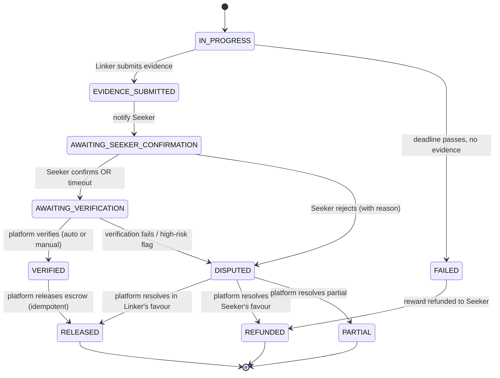

# Phase 14 — Verification-Gated Escrow Release

**Status:** ✅ Built (2026-10-15) · **Depends on:** Phase 5 (transactions/escrow), Phase 6 (connection), Phase 12 (lifecycle guards) · **Updated:** 2026-10-15

> **This was a spec; it is now implemented.** It closes the single most serious loophole
> in the blueprint's money path: the Seeker is currently the **sole arbiter of
> both "completion" and "payment release"**, with no independent gate. The fix
> inverts that — the Seeker *confirms*, the platform *verifies*, and only the
> platform *releases* escrow.
>
> Source of truth for the product rule: `../JOMLINK PLATFORM BLUEPRINT v1.md`
> **§5.7 Escrow Release Model** (rewritten 2026-10-15) and **§5.12.1
> Anti-Collusion Gates**.

---

## 1. The loophole being closed

Today the whole money path rests on one actor's self-certification:

- `markConnectionCompleteAction` (`src/app/actions/completions.ts`) is
  **Seeker-only** and calls `settleRewardRelease()` **in the same action** that
  marks the connection complete. The Seeker's click *is* the payment.
- There is **no hard gate** requiring evidence to exist, and **no platform-side
  verification**, before release. The `AWAITING_VERIFICATION` status exists in the
  enum and the labels but **no action ever sets it** — it is dead.

This enables three exploits:

1. **Collusion / self-dealing.** Seeker funds wallet → selects a colluding Linker
   → marks complete instantly (no evidence, no meeting) → Linker withdraws.
2. **Free meeting.** The Seeker receives the introduction (the actual value), then
   never marks complete. The 7-day fallback only fires **if a completion was
   recorded**, so a ghosting Seeker leaves the Linker unpaid.
3. **Toothless disputes.** Release is immediate on the Seeker's click, so there is
   no window to dispute the primary path.

---

## 2. The principle

> **The Seeker confirms. The Seeker does not pay. The Linker submits. The Linker
> does not self-certify. Only the platform releases escrow — and only after
> verification.**

The Seeker's confirmation becomes **one input** into a platform-owned release
decision. It is never, by itself, the release action.

---

## 3. Completion state machine



### State transition table

| From | To | Trigger | Actor | Escrow |
|------|----|---------|-------|--------|
| `IN_PROGRESS` | `EVIDENCE_SUBMITTED` | Evidence uploaded (immutable, timestamped) | Linker | Held |
| `EVIDENCE_SUBMITTED` | `AWAITING_SEEKER_CONFIRMATION` | Automatic, Seeker notified | System | Held |
| `AWAITING_SEEKER_CONFIRMATION` | `AWAITING_VERIFICATION` | Seeker confirms **or** `SEEKER_CONFIRM_WINDOW` elapses | Seeker / System | Held |
| `AWAITING_SEEKER_CONFIRMATION` | `DISPUTED` | Seeker rejects with a stated reason | Seeker | **Frozen** |
| `AWAITING_VERIFICATION` | `VERIFIED` | Automated checks pass (or manual review approves) | Platform | Held |
| `AWAITING_VERIFICATION` | `DISPUTED` | Checks fail / high-risk flag raised | Platform | **Frozen** |
| `VERIFIED` | `RELEASED` | Escrow paid to Linker, less 10% fee | **Platform only** | Released |
| any pre-release state | `DISPUTED` | Either party raises a dispute | Either | **Frozen** |
| `IN_PROGRESS` | `FAILED` | Deadline passes, no evidence, no accepted extension | System | Held |
| `FAILED` | `REFUNDED` | Reward returned to Seeker | Platform | Refunded |
| `DISPUTED` | `RELEASED` / `REFUNDED` / `PARTIAL` | Adjudication (§9.11) | Platform | Settled |

---

## 4. Timeout constants

Add to `src/lib/constants.ts` (alongside `FEES.RELEASE_WAIT_DAYS`):

```ts
export const COMPLETION = {
  // Seeker must confirm/reject evidence within this window. Timeout auto-advances
  // to verification — a silent Seeker can never block payment.
  SEEKER_CONFIRM_WINDOW_DAYS: 3,
  // Platform must verify within this window. Timeout auto-releases with a
  // post-hoc review flag — the platform can never stall payment.
  VERIFICATION_WINDOW_DAYS: 2,
  // Linker may fix deficient evidence before it is treated as failure.
  EVIDENCE_CURE_WINDOW_DAYS: 3,
  // Post-release clawback window.
  DISPUTE_WINDOW_DAYS: 7,
  // Mandatory hold before release for high-risk completions.
  HIGH_RISK_HOLD_DAYS: 7,
} as const;
```

---

## 5. Migration

New file `supabase/phase-14-verification-gated-release.sql` (idempotent, mirrors
the `phase-12-extension-approval.sql` style). **Required and not yet applied.**

```sql
-- ═══════════════════════════════════════════════════════════════
-- JOMLINK — Phase 14 Migration
-- Verification-Gated Escrow Release (blueprint §5.7, §5.12.1)
--
-- Run this ONCE in Supabase → SQL Editor.
-- Idempotent: safe to re-run.
-- ═══════════════════════════════════════════════════════════════

-- ── 1. Connection status enum: add the completion-workflow states ──
-- AWAITING_VERIFICATION already exists; add the three missing ones.
alter type jomlink.connection_status add value if not exists 'EVIDENCE_SUBMITTED';
alter type jomlink.connection_status add value if not exists 'AWAITING_SEEKER_CONFIRMATION';
alter type jomlink.connection_status add value if not exists 'VERIFIED';

-- ── 2. Completion-workflow columns on connections ────────────────
alter table jomlink.connections
  add column if not exists evidence_submitted_at      timestamptz,
  add column if not exists seeker_confirmed_at        timestamptz,
  add column if not exists seeker_confirmation_status text,  -- CONFIRMED | REJECTED | TIMED_OUT
  add column if not exists verification_status        text,  -- PENDING | PASSED | FAILED | MANUAL_REVIEW
  add column if not exists verified_at                timestamptz,
  add column if not exists verification_notes         text,
  add column if not exists risk_score                 integer,
  add column if not exists risk_level                 text,  -- LOW | MEDIUM | HIGH
  add column if not exists release_hold_until         timestamptz;

-- ── 3. Grants (mirror the base schema) ───────────────────────────
grant usage on schema jomlink to anon, authenticated, service_role;
grant all on jomlink.connections to service_role;
```

> **Note on `ALTER TYPE ... ADD VALUE`:** on PostgreSQL < 12 this cannot run
> inside a transaction block. Run the enum section on its own, or ensure the
> migration is not wrapped in `BEGIN/COMMIT` — the same caveat already documented
> in `jomlink-schema.sql` § 1b.

---

## 6. Code changes (file by file)

### 6.1 `src/lib/status.ts` — new predicates

Add the completion-workflow predicates next to the existing connection state
machine. **Keep them as allow-lists** (fail closed), unlike the existing
deny-list predicates — this is a money path.

```ts
/** Statuses in which the Seeker may confirm or reject submitted evidence. */
export const SEEKER_CONFIRMABLE_STATUSES = ["AWAITING_SEEKER_CONFIRMATION"] as const;

/** Statuses in which the platform may verify evidence. */
export const VERIFIABLE_STATUSES = ["AWAITING_VERIFICATION"] as const;

export function isSeekerConfirmable(status: string | null | undefined): boolean {
  if (!status) return false;
  return (SEEKER_CONFIRMABLE_STATUSES as readonly string[]).includes(status);
}

export function isVerifiable(status: string | null | undefined): boolean {
  if (!status) return false;
  return (VERIFIABLE_STATUSES as readonly string[]).includes(status);
}
```

### 6.2 `src/lib/jomlink-types.ts` — extend `ConnectionRow`

Add the new columns to the `ConnectionRow` interface (mirror the migration):

```ts
evidence_submitted_at: string | null;
seeker_confirmed_at: string | null;
seeker_confirmation_status: string | null;
verification_status: string | null;
verified_at: string | null;
verification_notes: string | null;
risk_score: number | null;
risk_level: string | null;
release_hold_until: string | null;
```

### 6.3 `src/lib/verification.ts` — NEW (pure, testable)

The risk-scoring + verification core. Keep it a plain module (not `"use server"`)
so it is unit-testable and shareable, mirroring `src/lib/release.ts`.

```ts
export interface VerificationInput {
  connectionId: string;
  evidenceCount: number;
  hasTargetAcknowledgement: boolean;
  progressReportCount: number;
  linkerIsFirstTime: boolean;
  seekerIsFirstTime: boolean;
  hoursSinceDeadlineAccepted: number;
}

export type RiskLevel = "LOW" | "MEDIUM" | "HIGH";

export function scoreCompletionRisk(input: VerificationInput): {
  riskLevel: RiskLevel;
  riskScore: number;
  reasons: string[];
};

export function isHighRisk(riskLevel: RiskLevel): boolean;
```

Risk rules (from blueprint §5.12.1):

- `HIGH` if: evidence submitted < a configurable minimum time after deadline
  acceptance; **or** first-time Linker **and** first-time Seeker; **or** zero
  progress reports; **or** no target acknowledgement on a meeting-type
  opportunity.
- `MEDIUM` if: any single weaker signal (e.g. evidence from non-corporate
  sources).
- `LOW` otherwise.

### 6.4 `src/app/actions/evidence.ts` — advance the state on submission

In `submitEvidenceAction`, after `createEvidence(...)` succeeds, set the
connection to `EVIDENCE_SUBMITTED` and stamp `evidence_submitted_at`:

```ts
await updateConnection(conn.id, {
  status: "EVIDENCE_SUBMITTED",
  evidence_submitted_at: new Date().toISOString(),
});
```

The existing `notifyUser(opp?.seeker_id, ...)` already tells the Seeker evidence
landed — keep it, and add the confirmation deadline to the body.

### 6.5 `src/app/actions/completions.ts` — split the action

**Replace** `markConnectionCompleteAction` with two actions. The money movement
(`settleRewardRelease`) moves **out** of the Seeker's action entirely.

#### `confirmEvidenceAction` (Seeker)

- Auth: `opp.seeker_id === user.id` (unchanged).
- Guard: `isSeekerConfirmable(conn.status)` — reject otherwise.
- Two paths:
  - **Confirm** → `updateConnection(conn.id, { status: "AWAITING_VERIFICATION",
    seeker_confirmed_at: now, seeker_confirmation_status: "CONFIRMED",
    verification_status: "PENDING" })`. **No money moves.**
  - **Reject (with reason)** → `updateConnection(conn.id, { status: "DISPUTED",
    release_status: "HELD", seeker_confirmation_status: "REJECTED" })` and create
    a dispute row (reuse `createDispute` from `disputes.ts` logic, or call a
    shared helper). A bare rejection is **not** a refund — it opens adjudication.
- Notify the Linker of the outcome.

#### `verifyCompletionAction` (platform / automated)

- Auth: admin permission (e.g. `disputes:resolve` or a new `completions:verify`)
  **or** the automated sweep (below).
- Guard: `isVerifiable(conn.status)`.
- Compute `scoreCompletionRisk(...)`.
  - `LOW`/`MEDIUM` → `updateConnection(conn.id, { status: "VERIFIED",
    verification_status: "PASSED", verified_at: now, risk_score, risk_level })`
    then call `settleRewardRelease(...)` and set `release_status = "RELEASED"`.
  - `HIGH` → set `release_hold_until = now + HIGH_RISK_HOLD_DAYS`,
    `verification_status = "MANUAL_REVIEW"`, and flag for manual review. Do **not**
    release.
- Idempotency: skip if `release_status` is already `RELEASED`/`REFUNDED`/`VOID`/
  `HELD` (reuse the existing guard pattern).

### 6.6 `src/app/actions/transactions.ts` — repurpose the sweep

`runAutoReleaseCheck` currently drains `COMPLETED` + `PENDING_RELEASE` rows. It
stays as the **fallback** for a completed-but-unreleased connection, but add a
second sweep (or extend it) that:

1. **Auto-advances** `AWAITING_SEEKER_CONFIRMATION` rows whose
   `evidence_submitted_at + SEEKER_CONFIRM_WINDOW_DAYS` has passed →
   `AWAITING_VERIFICATION` (silence is non-objection).
2. **Auto-verifies** `AWAITING_VERIFICATION` rows whose
   `seeker_confirmed_at + VERIFICATION_WINDOW_DAYS` has passed → run
   `scoreCompletionRisk` → release or hold (platform can never stall).
3. **Auto-releases** `VERIFIED` rows whose `release_hold_until` has passed.

New queries in `src/lib/queries.ts`:

```ts
listAwaitingSeekerConfirmation(now: Date): Promise<ConnectionRow[]>
listAwaitingVerification(now: Date): Promise<ConnectionRow[]>
listVerifiedHeld(now: Date): Promise<ConnectionRow[]>
```

New cron-ready route `GET /api/connections/verification-sweep` (same
`x-reconcile-secret` auth as `release-sweep` and `deadline-sweep`).

### 6.7 `src/app/dashboard/connections/[id]/actions.tsx` — split the UI

Replace `CompleteConnection` with a role-aware component:

- **Seeker, `AWAITING_SEEKER_CONFIRMATION`** → "Confirm evidence" / "Reject
  evidence (open dispute)" buttons calling `confirmEvidenceAction`.
- **Seeker, `AWAITING_VERIFICATION`** → read-only "Awaiting platform
  verification" state.
- **Seeker, `VERIFIED`** → read-only "Verified — reward released" state.
- **Linker** → read-only status of the completion workflow.

### 6.8 `src/app/dashboard/connections/[id]/page.tsx` — status labels

Add the new statuses to `CONN_STATUS_LABEL`:

```ts
EVIDENCE_SUBMITTED: "Evidence submitted",
AWAITING_SEEKER_CONFIRMATION: "Awaiting your confirmation",
VERIFIED: "Verified",
```

### 6.9 `src/lib/constants.ts` — status labels

Add the same three labels to `OPPORTUNITY_STATUS_LABELS` and
`CONNECTION_STATUS_LABEL` (in `status.ts`) so every surface renders them.

---

## 7. Anti-collusion gates (blueprint §5.12.1)

These are **enforced**, not advisory:

1. **Category-specific evidence requirements.** For meeting-type opportunities,
   the strongest signal is **target acknowledgement** — the Linker sends the
   target a Jomlink-generated confirmation link and the target confirms the
   meeting occurred. A colluding Seeker–Linker pair cannot fabricate this without
   the target's cooperation. (The `TARGET_ACKNOWLEDGEMENT` evidence type already
   exists in the enum.)
2. **Risk scoring on every completion** — `scoreCompletionRisk` above.
3. **Mandatory hold** — `HIGH` risk sets `release_hold_until` and requires manual
   review before release.
4. **Post-release clawback** — within `DISPUTE_WINDOW_DAYS` after release, a
   dispute may still be raised; it is a clawback dispute and the platform may
   reverse the payout by recovering from the Linker's wallet balance.

### Edge-case resolution

| Scenario | Outcome |
|----------|---------|
| Seeker ghosts after evidence | Auto-advance → verify → release if evidence passes. **Linker gets paid.** |
| Linker ghosts (no evidence) | Deadline passes → `FAILED` → refund to Seeker (§5.13 unchanged). |
| Both ghost | Deadline passes → `FAILED` → refund. |
| Seeker rejects evidence | `DISPUTED`, escrow frozen, adjudication — not a silent refund. |
| Deficient evidence | Linker gets `EVIDENCE_CURE_WINDOW_DAYS` to fix; then verify or dispute. |
| Collusion (fake meeting) | Target acknowledgement + risk scoring + hold + clawback. |
| Platform stalls | `VERIFICATION_WINDOW_DAYS` timeout auto-releases with a review flag. |

---

## 8. Definition of Done

- [x] Migration `supabase/phase-14-verification-gated-release.sql` written (**⚠️ must still be applied in Supabase**)
- [x] `submitEvidenceAction` advances the connection to `EVIDENCE_SUBMITTED`
- [x] `confirmEvidenceAction` (Seeker) confirms → `AWAITING_VERIFICATION`, or
      rejects → `DISPUTED` + `HELD` (no money moves on confirm)
- [x] `verifyCompletionAction` (platform) verifies → `VERIFIED` → release, or
      holds `HIGH` risk for manual review (core: `verifyCompletionCore` in `src/lib/completion.ts`)
- [x] `runVerificationSweep` auto-advances, auto-verifies, and auto-releases on the timeout windows
- [x] `GET /api/connections/verification-sweep` route exists and is idempotent
- [x] `src/lib/verification.ts` + `verification.test.ts` cover the risk rules
- [x] `src/lib/status.ts` predicates + tests cover the new states
- [x] UI is role-aware and never offers a state the server rejects
- [x] `npx tsc --noEmit` clean · `npm run build` passes · `npm test` passes (88 tests)

### Build notes (2026-10-15)

- The verify+release core was placed in **`src/lib/completion.ts`**
  (`completeAndRelease`, `verifyCompletionCore`) — a plain module, NOT
  `"use server"` — so the automated sweep can call it without exposing a new
  publicly-callable action endpoint. `verifyCompletionAction` and
  `runVerificationSweep` are thin callers.
- `markConnectionCompleteAction` was **deleted**; the money movement no longer
  lives in any Seeker-facing action.
- `notify(...)` is best-effort (never throws), so a notification failure can
  never roll back a release.

---

## 9. Verification plan

| Check | How |
|-------|-----|
| Seeker cannot release directly | Confirm the Seeker's action no longer calls `settleRewardRelease` |
| Collusion blocked | First-time pair + zero progress reports → `HIGH` risk → held |
| Ghosting Seeker | Leave a connection in `AWAITING_SEEKER_CONFIRMATION` past the window → sweep advances it |
| Platform stall | Leave a connection in `AWAITING_VERIFICATION` past the window → sweep verifies/releases |
| Idempotency | Re-run the sweep; no double-pay (existing `RELEASED`/`REFUNDED`/`VOID`/`HELD` guard) |
| Dispute freeze | Raise a dispute in any pre-release state → `HELD`, sweep skips it |

---

## 10. Out of scope (deliberate)

- Real target-acknowledgement link delivery (email/SMS to the target) — the
  `TARGET_ACKNOWLEDGEMENT` evidence type exists; the outbound channel is a
  follow-up.
- Automated evidence *content* analysis (image/PDF inspection) — risk scoring is
  metadata-based for now.
- Reversing a released payout automatically — clawback is an admin action.